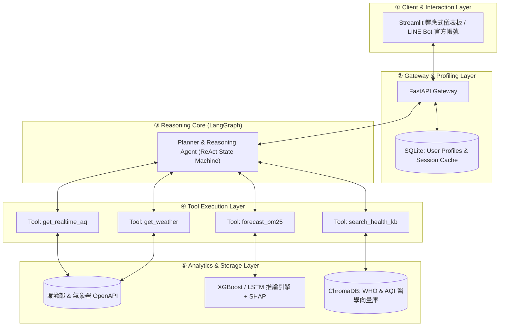

# DESIGN.md — AI Air Doctor 系統設計與開發移交文件

> **專案狀態**：Proposal & OpenSpec Refactor 階段（個人作業分支：`refactor/openspec-proposal`）  
> **指導教授**：陳煥 教授  
> **開發團隊**：7115093066_楊禾睿、7115093063_徐崇皓、7115064183_謝秉樺、7115064202_譚人傑  
> **OpenSpec 工作流**：本設計已轉換為 [openspec/changes/ai-air-doctor-mvp/](openspec/changes/ai-air-doctor-mvp/) 下之 `spec-driven` 工作流（`proposal → specs → design → tasks`）。  
> **維護規範**：本文件依據作業要求之「標準移交鏈條（Standard Handover Pipeline）」編撰，旨在使任何後續接手的開發者皆能無縫理解、本機重現、驗證並持續迭代本專題。

---

## 移交導引鏈條（Handover Pipeline Overview）
```
Problem ──> Requirements ──> Architecture ──> Components ──> Data
  └──> AI/Analytics ──> Domain Knowledge ──> Algorithm ──> Implementation
         └──> How to Run ──> Results & Evaluation
```

---

## 1. Problem（核心問題定義）
空氣污染（PM2.5、O₃、NO₂）已成為全球第二大早逝風險因子。傳統監測方案存在三大斷層：
1. **數值與行動脫節**：政府測站與現存 App 僅廣播抽象的 AQI 數值或顏色，未與個人疾病（氣喘、COPD、心血管疾病）與生活作息（晨跑、通勤、通風開窗）連動。
2. **純模型無語意**：學術界預測模型多為純黑盒子數值回歸（如 LSTM、Transformer），一般大眾無法理解預測數字背後的氣象成因。
3. **通用 AI 醫療幻覺**：通用 LLM 缺乏即時在地 IoT 數據感知能力，且缺乏臨床醫學約束，極易捏造錯誤之防護偏方。

---

## 2. Requirements（系統軟硬體需求規範）

### 2.1 功能性需求（Functional Requirements）
* **FR-1（即時多源感知）**：支援根據使用者輸入之經緯度或地標名稱，調取方圓 **3 公里**內環境部標準測站作為基準，並整合方圓 **1 公里**內民生公共物聯網（Civil IoT）微型感測器即時數值；當 RH > 75%（尤其 > 85%）時執行濕度補償並擴展至 **5 公里**標準站進行離群比對。
* **FR-2（前瞻趨勢預報）**：提供目標地點未來 1 至 24 小時之逐時 PM2.5 濃度預測與 95% 信賴區間（嚴格時間切分，不採用隨機 K-Fold）。
* **FR-3（特徵成因歸因）**：透過 SHAP 值動態產出氣象成因分析（逆溫層滯留、弱風累積、光化臭氧）。
* **FR-4（個人化暴露換算）**：依據使用者健康檔案（年齡、病史）與活動強度換氣係數，換算個體吸收暴露量，並對齊 **WHO 2021（日均 15 μg/m³）** 與 **台灣 MOENV 2024/2025 修訂標準（日均 30 μg/m³）** 雙軌門檻。
* **FR-5（醫療知識檢索與反思）**：整合 RAG 檢索臨床醫學知識，輸出建議必須強制附帶資料來源與醫學指引出處，不符標準者自動觸發 `SafetyGuardrail` 反思重新生成。

### 2.2 非功能性需求（Non-Functional Requirements）
* **NFR-1（響應延遲）**：端到端對話串流首字延遲 $\le 1.5$ 秒，完整決策報告生成 $\le 5$ 秒。
* **NFR-2（容錯與離線機制）**：若政府 OpenAPI 連線超時（> 3s），系統自動降級讀取 SQLite 本機最近有效快取，並主動提示使用者。
* **NFR-3（隱私安全）**：個人健康檔案（病史、年齡）僅保存在本機 SQLite，嚴禁未去識別化上傳至外部日誌。

---

## 3. Architecture（系統總體架構）

系統依據八步式架構嚴格解耦，採用分層模組化設計：



---

## 4. Components（各子組件規格）

| 組件編號 | 組件名稱 | 核心職責 | 關鍵技術 / 函式庫 |
| :---: | :--- | :--- | :--- |
| **C-1** | `AgentOrchestrator` | 狀態機流程控制、意圖識別、Tool 調用與 Guardrail 循環 | LangGraph, LangChain-Core |
| **C-2** | `MeteoDataCollector` | 串接環境部與氣象署 OpenAPI，進行空間最近鄰近站點匹配 | `requests`, `geopy`, `tenacity` |
| **C-3** | `AeroForecastEngine` | 載入訓練好之 XGBoost/LSTM 權重，進行特徵工程與時序預測 | `xgboost`, `torch`, `scikit-learn` |
| **C-4** | `SHAPExplainer` | 計算各氣象特徵之 Shapley 貢獻值，轉譯為人類可讀的大氣診斷 | `shap`, `numpy` |
| **C-5** | `MedicalRAGRetriever`| 依據活動與疾病關鍵字檢索向量庫中最佳防護指引 | `chromadb`, `sentence-transformers` |
| **C-6** | `SafetyGuardrail` | 正則與語意比對，強制驗證回答內包含數據來源與引用標註 | 自建規則引擎 + LLM 反思模組 |

---

## 5. Data（資料來源、前處理與儲存規格）

### 5.1 資料來源對照
1. **環境部空氣品質監測網 OpenAPI**（每小時）：PM2.5、PM10、O₃、CO、SO₂、NO₂、AQI。
2. **民生公共物聯網 (Civil IoT)**（每 5 分鐘）：高密度微型感測器溫濕度與微粒數。
3. **中央氣象署開放平台**（每小時）：氣溫、相對濕度、風向、風速、降雨量。

### 5.2 前處理與特徵管線（Feature Pipeline）
* **欠測補值**：時序短暫缺失（$\le 3\text{h}$）使用線性插值；超過 3 小時使用空間反距離加權法（IDW）由鄰近測站推補。
* **風向正交分解**：
  $$u = - \text{wind\_speed} \cdot \sin\left(\text{wind\_dir} \cdot \frac{\pi}{180}\right)$$
  $$v = - \text{wind\_speed} \cdot \cos\left(\text{wind\_dir} \cdot \frac{\pi}{180}\right)$$
* **日夜週期特徵**：加入正弦與餘弦時間編碼：$\sin(2\pi \cdot \text{hour}/24), \cos(2\pi \cdot \text{hour}/24)$。
* **逆溫潛勢特徵**：計算日夜溫差指標 $\Delta T = T_{\text{surface}} - T_{\text{dewpoint}}$。

---

## 6. AI & Analytics（演算法與分析引擎）

### 6.1 數值預測模型
* **XGBoost 快速回歸**：設定 `n_estimators=500, max_depth=6, learning_rate=0.03`，使用過去 24 小時之滑動特徵（Lag Features, Rolling Mean）。
* **LSTM 時序神經網絡**：設計 2 層雙向 LSTM，隱藏單元為 128，引入 Dropout (0.2) 防止過擬合，輸出序列長度為 24 小時。

### 6.2 SHAP 特徵歸因
計算預測時間點之 Shapley Values，排序出前三大影響因子：
* 例如：「風速低於 0.8 m/s（正向貢獻 +18 μg/m³，主因為大氣擴散停滯）」、「相對濕度高於 85%（正向貢獻 +12 μg/m³）」。

---

## 7. Domain Knowledge（領域知識庫建置）

知識庫收錄內容經專家結構化分級，存入 ChromaDB 向量集合：
1. **指引文件 A**：《WHO 2021 全球空氣品質指引（繁體精要版）》
2. **指引文件 B**：《台灣環境部 2024/2025 修訂 AQI 分級暨 2025《空氣品質政策白皮書》早晚分流應變處方表》
3. **指引文件 C**：《台灣胸腔暨重症加護醫學會氣喘臨床共識暨衛福部國健署空污防護 3 招》
4. **指引文件 D**：《室內通風換氣（含緊閉留 5 公分縫隙與 10–15m 脈衝換氣）與空氣清淨機 CADR 選型計算指南》

---

## 8. Algorithm（核心演算法邏輯）

系統遵循兩大關鍵演算法：
* **Algorithm 1（AI Air Doctor Agent 主推理管線）**：解析意圖 $\to$ 判斷時態 $\to$ 呼叫即時或預測工具 $\to$ 計算個體暴露劑量 $\to$ RAG 檢索醫療指南 $\to$ 護欄檢驗與反思修訂 $\to$ 結構化輸出。
* **Algorithm 2（時序氣象預測管線）**：KNN 時空補值 $\to$ 風向分解與滯後特徵工程 $\to$ Time-based Split $\to$ 訓練 XGBoost/LSTM $\to$ 產出 RMSE/MAE 評估結果。

---

## 9. Implementation（系統實作目錄結構）

```
DIC3_Proposal_Refactor_OpenSpec/
├── openspec/                     # OpenSpec spec-driven 工作流 (proposal / specs / design / tasks)
│   ├── config.yaml               # 專案背景與規格規則設定
│   └── changes/ai-air-doctor-mvp/# 由 DESIGN.md 轉換之完整變更提案與 4 大能力規格
├── docs/
│   ├── proposal.md                      # 提案主文件 (A–F、A2Z 映射、Introduction/Related Work Refactor、5/3/10 深研與虛擬碼)
│   ├── Proposal_AI_Air_Doctor.docx      # 自動編譯之 Word 提案書
│   ├── Proposal_AI_Air_Doctor.pptx      # 自動編譯之 25 頁專業簡報檔 (>20 pages)
│   ├── AI_Air_Doctor_Proposal_Analysis.md   # 對標《期末專題規範》×《2020 A-Z SOP》× OpenSpec 之完整系統性解析報告
│   ├── AI_Air_Doctor_Proposal_Analysis.docx # 解析報告 Word 編譯版
│   └── img/                             # architecture.png、flowchart.png、infographic_A4.png (300 DPI A4)
├── src/                                 # (規劃實作目錄，詳見 openspec tasks.md)
│   ├── agent/                           # ReAct 代理人與狀態機
│   ├── models/                          # XGBoost / Bi-LSTM 預測模型
│   ├── tools/                           # OpenAPI 串接與 RAG 檢索器
│   └── web/                             # Streamlit / FastAPI 介面
├── data/                                # (規劃目錄) 知識庫原始文檔與樣本測站數據
├── scripts/
│   ├── diagrams.py                      # 系統架構圖與流程圖繪製腳本
│   ├── render_infographic.py            # A4 橫式高密度編號資訊圖表渲染腳本
│   ├── build_docx.py                    # 提案與解析報告雙 Word 自動生成器
│   └── build_pptx.py                    # 25 頁提案簡報 PPT 自動生成器
├── DESIGN.md                            # 本設計移交文件
└── README.md                            # 專案首頁說明
```

---

## 10. How to Run（重現與執行步驟）

### 環境準備
```bash
# 1. 建立並啟動 Python 虛擬環境
python -m venv .venv
# Windows:
.\.venv\Scripts\activate

# 2. 安裝文件與圖表生成套件 (src/ 實作期套件將於 W1–W2 建立 requirements.txt)
pip install python-docx python-pptx matplotlib pillow requests
```

### 生成圖表、驗證 OpenSpec 與編譯文件
```bash
# 3. 驗證 OpenSpec spec-driven 規格與任務狀態
openspec.cmd status --change ai-air-doctor-mvp
openspec.cmd validate ai-air-doctor-mvp

# 4. 重新繪製架構圖、流程圖與 A4 橫式資訊圖表 (Windows 虛擬環境可用 .\.venv\Scripts\python.exe)
python scripts/diagrams.py
python scripts/render_infographic.py

# 5. 編譯輸出正式提案與解析 Word 及 25 頁 PPT 文件
python scripts/build_docx.py
python scripts/build_pptx.py
```

---

## 11. Results & Evaluation（預期成果與驗證指標）

| 評估維度 | 目標基準（Baseline） | 本專題預期達成指標（統一口徑） | 驗證方法 |
| :--- | :--- | :--- | :--- |
| **預測 RMSE (24h)** | 14.8 μg/m³ (Persistence) | **$\le 9.5\ \mu\text{g/m}^3$** (降低 35% 以上，6h $R^2 \ge 0.82$) | 2025 年台灣測站純盲測集（含臺中代表站子集 `E1`） |
| **醫學建議對齊率** | 68% (未外掛工具之原始 LLM) | **$\ge 95\%\text{–}96\%$** | 30 組脆弱／異常案例盲測 (`E2`) |
| **醫療偽偏方幻覺率** | 22% (通用 LLM) | **$\le 2\%\text{–}3\%$**、**100% 來源揭露率** | 引用來源強制勾稽與自我反思機制 (`E2`) |
| **SHAP 成因可解釋性** | 無歸因解釋之純文字輸出 | **專家診斷一致度 $\ge 4.5 / 5$** (Likert) | 10 場台灣典型高污染事件評核 (`E3`) |
| **端到端延遲、降級與易用性** | > 8 秒 | **平均 $\le 4.2$ 秒**（95% $\le 5$ 秒）、**安全降級率 100%**、**SUS $\ge 80$** | 100 次並行請求暨故障注入與問卷 (`E4`) |

---

## 12. Limitations & Handover（系統限制與後續移交規劃）

### 12.1 提案階段邊界聲明（Proposal Stage Boundary）
* **預期目標與實測分離**：目前專案處於 Proposal & OpenSpec 規格定稿階段（`src/` 與 `tests/` 尚未進入開發），§11 所列指標均為依據規格定義之 **Expected Outcomes**，嚴禁虛構尚未執行的實驗數據；後續將於 W1–W8 實作與 E1–E4 測試完成後以實測數據回填更新本文件。

### 12.2 技術、感測與應用限制（System Limitations）
1. **無室內 CO₂ 感測之換氣推估限制**：台灣多數一般住宅缺乏室內 CO₂ 感測器，於室外紅害與室內認知衰退的脈衝換氣（10–15 分鐘）權衡中，現階段僅能依據時序預報低谷與空間人數啟發式給予建議，尚無法即時讀取真實室內 CO₂（對應 `openspec/changes/ai-air-doctor-mvp/design.md` Open Questions）。
2. **微型感測器物理漂移與定位邊界**：Civil IoT 光散射微感測器無加熱除濕裝置，於高濕環境（`RH > 75%`／`> 85%`）及長期曝露老化下仍可能出現飄移，僅作社區微環境輔助預警，不能取代環境部法規測站作為執法依據。
3. **時序預測模型目前聚焦 PM2.5**：`Algorithm 2` 與 `E1` 優先針對未來 1–24 小時 PM2.5 濃度進行建模；夏季午後光化學臭氧（O₃）等其他指標現階段以即時多污染物觀測監控為主，尚未建置獨立 24 小時 O₃ 預測模型。
4. **外部服務與運算延遲依賴**：系統依賴政府 OpenAPI（超過 3 秒自動降級為 72 小時 SQLite 快取）及語言模型推理服務，須在平均 $\le 4.2$ 秒（95% $\le 5$ 秒）預算內維持繁體中文醫療引用格式與護欄通過率。
5. **非臨床醫療診斷定位**：本系統僅供個人化環境暴露評估與生活防護參考，不具備臨床醫師醫療診斷、處方或急症分診效力；所有輸出皆強制呈現固定免責聲明。

### 12.3 後續實作與交接規劃（Handover Checklist）
* **W1–W8 開發追蹤**：依照 [tasks.md](openspec/changes/ai-air-doctor-mvp/tasks.md) 5 大階段共 **19 項**可追蹤任務依序建置 `src/tools/`、`src/models/`、`src/agent/`、`src/web/` 與 `tests/`，並逐一完成 E1–E4 驗證。
* **雙軌文件維護**：後續每次完成關鍵功能或實驗後，須同步更新 [README.md](README.md)、本文件 `DESIGN.md`（Implementation Mapping / Results / Limitations）與 OpenSpec 任務狀態，確保下一位開發者可依 GitHub 專案直接重現、驗證並接手開發。
