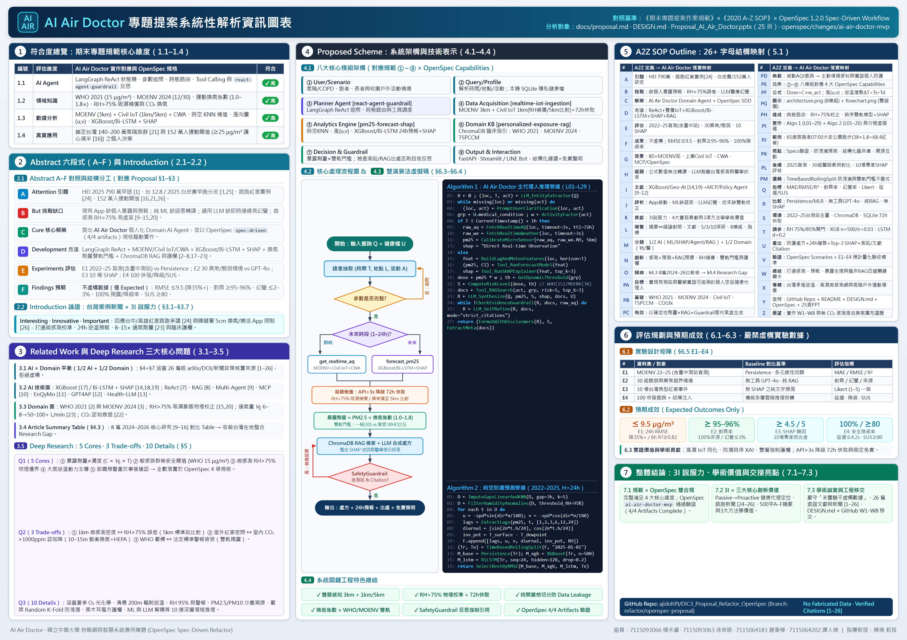

# AI Air Doctor 專題提案系統性解析報告（對標期末專題規範 × 2020 A-Z SOP × OpenSpec）

**AI Air Doctor: Systematic Proposal Analysis Aligned with Final Project Requirements, 2020 A-Z SOP, and OpenSpec Spec-Driven Workflow**

組員：7115093066_楊禾睿、7115093063_徐崇皓、7115064183_謝秉樺、7115064202_譚人傑  
課程：物聯網與智慧系統應用專題（OpenSpec Refactor 版）  指導教授：陳煥 教授

---

## 一、依據《期末專題提案作業規範》核心維度檢視符合度

本節依據課程附件《期末專題提案作業規範》之四大核心軸線與各階段技術交付規格，系統性檢核 [proposal.md](proposal.md)、[DESIGN.md](../DESIGN.md)、OpenSpec 變更套件（`openspec/changes/ai-air-doctor-mvp/`）以及簡報 [Proposal_AI_Air_Doctor.pptx](Proposal_AI_Air_Doctor.pptx) 之符合程度。

### 1.1 核心定位符合度（AI Agent + Domain Knowledge + Data Analytics + Real-World Application）

規範明確要求本專題「**不應只訓練一個 AI Model 或製作單純 Chatbot**」，而必須設計具領域推理、工具取得資料與驗證建議能力的 **Domain AI Agent**。

| 編號 | 規範核心維度 | AI Air Doctor 設計實踐與對應模組 | 關鍵實證／規格落點 | 符合度 |
| :---: | :--- | :--- | :--- | :---: |
| **1.1** | **AI Agent**（推理與調度） | 以 **LangGraph ReAct** 狀態機為 Planner 核心，執行實體抽取、缺少參數追問迴圈（Clarification Loop）、時態路由（即時 vs. 1–24h 預測）、多工具調度與強制引用反思護欄（`SafetyGuardrail`）。 | [proposal.md](proposal.md) §6.1 ③、§6.4 Algorithm 1；OpenSpec `react-agent-guardrail/spec.md` | **✓ 高** |
| **1.2** | **Domain Knowledge**（領域知識） | 導入 **WHO 2021** 嚴格指引（PM2.5 24h `15 μg/m³` / 年均 `5 μg/m³`）[2]、**MOENV 2024/2025** 加嚴標準（年均 `12` / 日均 `30 μg/m³`）[3]、運動換氣係數（靜態 `1.0` 至劇烈跑步 `1.8`，對應 V_E 8–15 倍與沉積負荷 >4.5 倍 [23]）、高濕光散射吸濕膨脹校正（`RH > 75% / > 85%` [15, 20]）與室內 CO₂ 認知衰退權衡（`>1,000–1,400 ppm` 採 10–15 分鐘脈衝換氣 [22]）。 | [proposal.md](proposal.md) §4.2、§5（Q1–Q3）；OpenSpec `personalized-exposure-rag/spec.md` | **✓ 高** |
| **1.3** | **Data Analytics**（多源數據分析） | 串接 **MOENV** 標準測站（半徑 `3 km` 基準）+ **Civil IoT Taiwan** 微型感測器（`1 km` 高密度，異常擴展 `5 km` 交叉比對）+ **CWA** 中央氣象署逐時氣象；執行線性插值（`≤3h`）／時空 KNN（`>3h`）補值、風向量正交分解 `(u, v)`、日夜週期與逆溫潛勢 `ΔT`，透過嚴格時間切分（`TimeBasedRollingSplit`）訓練 **XGBoost + 2-Layer Bi-LSTM** 並輸出 **SHAP** 前三大成因。 | [proposal.md](proposal.md) §6.4 Algorithm 2；OpenSpec `realtime-iot-ingestion/spec.md`、`pm25-forecast-shap/spec.md` | **✓ 高** |
| **1.4** | **Real-World Application**（真實場域應用） | 鎖定台灣受東北季風與背風面逆溫滯留影響之真實族群：全台推估 **140 至 200 萬名**受氣喘影響人口 [21]、COPD 長者與戶外運動者（中興大學團隊 2025 年 152 萬人研究證實長期 PM2.5 `≥ 25 μg/m³` 使運動降死亡效益由 30% 減半至 12–15% [16]）。 | [proposal.md](proposal.md) §1、§3.1–§3.3；FastAPI + Streamlit / LINE Bot 雙介面 | **✓ 高** |

### 1.2 Abstract（摘要）與 Introduction（緒論）結構對照

* **Abstract 六段式（A–F）完整呼應**：
  * **A. Attention Getter**：引用 HEI《State of Global Air 2025》全球 790 萬空污早逝 [1]、台灣 2024 年均 `12.8 μg/m³`（台中降至 `12.9 μg/m³`）[3, 24]、2024/09 修訂標準 [3]、2025/05《空氣品質政策白皮書》2030/2035 願景暨早晚分流預報 [25]、中南部馬拉松紅害爭議實例 [24]、140–200 萬氣喘人口暨國健署防護 3 招 [21, 26] 及 152 萬人運動保護減半實證 [16]。
  * **B. But（挑戰）**：精確點出現行監測 App（環境即時通、樂活氣象 APP）僅被動顯示單點數值、無個人劑量與前瞻預報、傳統 ML 缺語意轉譯、通用 LLM 缺即時感測與臨床護欄易生幻覺，以及微感測器 `RH > 75%` 虛高問題 [9–15, 20]。
  * **C. Cure（解藥）**：提出 **AI Air Doctor** Domain AI Agent，並以 OpenSpec `spec-driven`（4/4 artifacts）落實規格驅動工程。
  * **D. Development（方法）**：結合 LangGraph ReAct、雙層 IoT（3 km + 1 km/5 km）與 CWA 氣象、XGBoost/Bi-LSTM 24h 預報 + SHAP、活動換氣暴露係數 × 雙軌門檻、ChromaDB RAG 與 `SafetyGuardrail`。
  * **E. Experiments（評估）**：規劃 E1（2022–2025 盲測含臺中代表測站對比 Persistence／線性回歸）、E2（30 組異常與脆弱情境對比無工具 GPT-4o 與純 RAG）、E3（10 場典型紅害事件 SHAP 專家一致度）、E4（100 次並行請求延遲、安全降級率與 SUS 問卷）。
  * **F. Findings（預期產出）**：嚴格遵循「**未實驗者僅列 Expected Outcomes，不虛構數據**」，預期達成 24h RMSE 較基準降 35% 以上（`≤ 9.5 μg/m³`，6h `R² ≥ 0.82`）、指引對齊率 `≥ 95%–96%`、幻覺率 `≤ 2%–3%`、**100% 來源揭露與安全降級觸發率**、平均延遲 `≤ 4.2s`（95% `≤ 5s`）、SUS `≥ 80`。
* **Introduction 論證精神（3I 原則 × 新聞案例 × 預期貢獻與學術價值）**：以「65 歲氣喘者明早 07:00 公園慢跑與開窗時機」及台灣馬拉松紅害新聞爭議 [24] 為主軸，於 [proposal.md](proposal.md) §3.6–§3.7 系統整理 **預期工程與實務貢獻（4 維度）**、**預期學術研究價值（3 項跨領域方法學價值）** 與 **3I 說服力論證（Interesting · Innovative · Important）**。

### 1.3 Related Work 與 Deep Research 三大核心問題

* **1/2 AI + 1/2 Domain 文獻平衡與查證**：
  * **AI 技術面**：涵蓋 XGBoost [17]、SHAP [18]、台灣地形集成預報 [14, 19]、ReAct [7]、RAG [8]、Multi-Agent 野火空品分析 [9]、MCP 空品監測介面 [10]、EnQyMo 代理平台 [11]、GPT4AP 氣象預報 LLM [12] 與 Health-LLM [13]。
  * **Domain Know-how 面**：涵蓋 WHO 2021 [2]、台灣 MOENV 2024/2025 法規 [3]、Civil IoT 微型感測網 [4, 5]、RH>75% 光散射吸濕誤差與校正 [15, 20]、運動通氣與微粒沉積 [16, 23]、氣喘盛行率 [21] 與室內 CO₂ 認知衰退實證 [22]。
  * **Article Summary Table（§4.3）**：涵蓋 8 篇經查證之 2024–2026 核心文獻（[9]–[16]），精準收斂至 `Existing Research → Limitations → Research Gap → Our Project`。
* **Deep Research 三大問題對照（§5）**：
  * **Q1（5 Cores）**：完整定義「暴露劑量 ≠ 環境濃度」、「敏感族群無安全閾值」、「微環境異質與感測物理」、「大氣動力學非線性主導」、「前瞻預警重於事後確認」，並逐一寫入 OpenSpec `specs/*/spec.md` 可驗證場景。
  * **Q2（3 Trade-offs）**：依「觀點 A ↔ 觀點 B → Evidence → Consensus → Unresolved Problems → OpenSpec 權衡」剖析微型感測密度 vs 高濕誤差、室外密閉 vs 室內 CO₂ 認知衰退、WHO 嚴格標準 vs 法定標準與警報疲勞。
  * **Q3（10 Details）**：涵蓋 Why（O₃ 光化）、What-if（200m 輻射逆溫）、Trade-off（85 μg/m³ vs 1,400+ ppm CO₂ 會議室）、Failure Case（RH 95% 假紅害）、Evidence（38 μg/m³ 跑步說服證據）、Comparison（沙塵暴 vs 本地排放 PM2.5/PM10 比值）、Design Decision（嚴禁 Random K-Fold 防時序洩漏）、Real-world Scenario（孕婦 vs 異位性皮膚炎青年）、Failure Case（黑木耳／綠茶清肺偏方攔截）、Design Decision（ML/SHAP 與 LLM 解耦）。

### 1.4 Proposed Scheme（系統架構與技術表示）

* **八大模組（①–⑧）**：從 ① User/Scenario、② Query/Profile、③ Planner Agent、④ Data Acquisition、⑤ Analytics Engine、⑥ Domain Knowledge Integration、⑦ Decision & Guardrail 到 ⑧ Output & Interaction 逐一編號說明，並附上 [architecture.png](img/architecture.png)（§6.2）。
* **Flowchart（§6.3）與雙演算法虛擬碼（§6.4）**：[flowchart.png](img/flowchart.png) 呈現參數缺失主動追問迴圈、時態分支、API>3s 72h SQLite 降級／RH>75% 補償與 `SafetyGuardrail` 自我反思迴圈；Algorithm 1（L01–L29）與 Algorithm 2（L01–L20）完整附帶行號與數學處理細節。

---

## 二、依據《2020 A-Z SOP Outline》完整 26+ 字母結構映射解析

下表參照《A2Z outline example.pdf》（2020 A-Z SOP）之全論文／提案架構，將 **Abstract（A–F）、Introduction（G–L）、Related Work（M–O）、Proposed Scheme（PA–PM）、Simulation（Q–V）與 Conclusion（W–Z）** 逐項映射至 **AI Air Doctor** 之系統落實與 OpenSpec 規格：

| 字母 | A2Z SOP 核心定義 | AI Air Doctor 具體落實與內容映射 | 對應章節／OpenSpec 規格 |
| :---: | :--- | :--- | :--- |
| **A** | **Attention Getter**：動機與引題 | 引用 HEI 2025 全球 790 萬早逝 [1]、台灣 2024 年均 `12.8` / 白皮書 2030·2035 目標 [3, 25]、中南部路跑紅害實例 [24]、140–200 萬氣喘 [21, 26] 與 152 萬人 `≥ 25 μg/m³` 運動減效 [16]。 | §1 (A)、§2.0、§3.1 |
| **B** | **But**：挑戰與現有不足 | 官方 App（環境即時通／樂活氣象）缺個人暴露與預報；純 ML 缺行動轉譯；通用 LLM 缺即時感測與護欄易幻覺；微感測 `RH > 75%` 易虛高 [9–15, 20]。 | §1 (B)、§2.0、§3.4 |
| **C** | **Cure**：提出的創新解藥 | 提出個人化領域智慧代理人 **AI Air Doctor**，整合雙層感測、時序預報＋SHAP 與臨床 RAG 護欄。 | §1 (C)、§6.1 |
| **D** | **Development**：方法設計依據 | LangGraph ReAct 串接 MOENV（3 km）+ Civil IoT（1 km/5 km）+ CWA、XGBoost/Bi-LSTM + SHAP、換氣係數 × 雙軌門檻、ChromaDB 與反思護欄。 | §1 (D)、§6.1–§6.4 |
| **E** | **Experiments**：評估規劃 | 規劃 2022–2025 逐時資料（2025 盲測含臺中代表站）對比 Persistence/MLR（E1）、30 組脆弱／異常情境（E2）、10 場 SHAP 評核（E3）與 100 併發/降級/SUS（E4）。 | §1 (E)、§6.5 |
| **F** | **Findings**：預期成果（無虛構） | 嚴禁虛構數據；預期 24h RMSE `≤ 9.5 μg/m³`（降 35%+，6h `R² ≥ 0.82`）、對齊 `≥ 95–96%`、幻覺 `≤ 2–3%`、100% 引用與安全降級率、延遲 `≤ 4.2s`、SUS `≥ 80`。 | §1 (F)、§6.5 |
| **G** | **General**：領域大背景現況 | 台灣具備 80+ 座環境部測站（並推出早晚分流預報 [25]）、上萬顆民生公共物聯網微型感測器與 CWA 氣象，結合 ReAct、RAG、MCP 與 OpenSpec SDD [3–8, 10]。 | §3.2 |
| **H** | **However**：深層技術與應用瓶頸 | 面對真實提問與路跑／密閉換氣衝突 [22, 24]，現有系統難以同時解決微環境校正、前瞻逆溫預報、運動通氣 8–15 倍劑量與可驗證處方四大關卡。 | §3.3、§3.4 |
| **I** | **In literature**：文獻發展梳理 | 從傳統樹模型／時空集成（XGBoost [17]、Geo-AI+SHAP [14]、Puli ML [19]）演進至代理型空品／醫療 LLM（Instructor-Worker [9]、MCP [10]、EnQyMo [11]、GPT4AP [12]、Health-LLM [13]）。 | §4.1 |
| **J** | **Judgement**：各方法優劣點評析 | 表列對比官方 App（缺預報與劑量）、ML 模型（黑盒無自然語言處方）、通用 LLM（無即時數據與幻覺）、近期 Agent（缺台灣高濕校正與雙軌臨床 RAG）。 | §3.4、§4.3 |
| **K** | **Keypoint**：核心設計與學術貢獻 | 三維閉環架構與 `SafetyGuardrail`；於 §3.6–§3.7 系統歸納 **四大實務貢獻**、**三大跨領域學術研究價值** 與 **3I 說服力論證**。 | §3.5、§3.6、§3.7 |
| **L** | **List organization**：文章結構導覽 | 依序安排摘要（§1）、摘要↔緒論暨 A2Z 對照（§2）、緒論與 3I／學術價值（§3）、1/2 AI+1/2 Domain 相關研究（§4）、深研 5/3/10（§5）、Proposed Scheme（§6）與文獻（§7）。 | §2、§3–§7 |
| **M** | **Methods**：既有文獻方法分類 | 嚴格平衡 1/2 AI Technology（時序回歸 + SHAP + Tool Calling / MCP + RAG）與 1/2 Domain Know-how（法規、吸濕物理、運動生理、CO₂ 認知）。 | §4.1、§4.2 |
| **N** | **New proposed**：本專案創新技術 | 將 `RH > 75%` 光散射補償、時間防漏預測、運動通氣加權 `effective_dose`、WHO/MOENV 雙軌分級與 `SafetyGuardrail` 自我反思封裝為 OpenSpec 四大能力。 | §3.5、§6.1 |
| **O** | **Organize**：文獻比較與歸納表 | §4.3 完整表列 8 篇 2024–2026 研究（Ref / Year / Problem / AI / Domain / Dataset / Findings / Limitation），於 §4.4 收斂出 Research Gap。 | §4.3、§4.4 |
| **PA** | **Aim**：研究目標陳述 | 打造懂大氣與環境醫學、會取台灣即時數據、能 24h 定量歸因且 100% 有出處可查的個人化空氣品質健康代理人。 | §1 (C)、§3.3 |
| **PB** | **Based on**：依託基礎與背景 | 依託 MOENV/Civil IoT/CWA 三大開放平臺 [3–6]、WHO 2021 [2]、MOENV 2024 [3]、胸腔重症氣喘指引 [21] 與四本結構化臨床知識手冊。 | §3.2、§6.1 ⑥ |
| **PC** | **Cure / Cause**：機制有效的原因 | 以確定性氣象模型與暴露公式取代 LLM 猜測數字；以 ChromaDB RAG 與 `SafetyGuardrail` 強制核對測站與指引來源，杜絕黑木耳清肺等偽建議。 | §5 (Q3-9/10)、§6.1 ⑦ |
| **PD** | **Design**：系統架構典範轉移 | **核心研究價值**：從「被動式單點 AQI 查詢（Passive Point AQI Lookup）」邁向「主動式、情境感知、生理劑量量化與實證可追溯的個人化空氣品質健康代理（Proactive, Context-Aware & Evidence-Grounded Agent）」。 | §3.5、§6.1 |
| **PE** | **Paper Element**：模組元件清單 | 嚴格對應 ①–⑧ 八大模組與 `C-1 AgentOrchestrator` 至 `C-6 SafetyGuardrail` 元件及 OpenSpec 4 大 Capability Specs。 | §6.1、[DESIGN.md](../DESIGN.md) §4 |
| **PF** | **Formulation**：功能與數學形式 | `effective_dose = PM2.5 × activity_weight`；風向量 `u = -spd·sin(dir·π/180)`、`v = -spd·cos(dir·π/180)`；逆溫潛勢 `ΔT = T_surface - T_dewpoint`；日夜 `sin/cos`。 | §6.4 Algo 1 & 2 |
| **PG** | **Graph**：架構圖與流程圖 | 提供具 ①–⑧ 編號之系統架構圖（`architecture.png`）與含參數追問、API 降級、RH 校準及護欄反思之流程圖（`flowchart.png`），另附 A4 總覽資訊圖表（`infographic_A4.png`）。 | §6.2、§6.3、§6.7 |
| **PH** | **How**：如何達成設計目標 | 透過時態分流路由、雙層空間加權（3km + 1km/5km）、時空 KNN 補值、XGBoost/Bi-LSTM 依 RMSE 擇優、SHAP 拆解前三大因子與雙軌門檻分級達成。 | §6.1 ④–⑦ |
| **PI** | **Implementation**：虛擬碼落實 | 提供完整具行號虛擬碼：`Algorithm 1`（L01–L29，含澄清與反思雙迴圈）與 `Algorithm 2`（L01–L20，含防漏切分與雙模型訓練）。 | §6.4 |
| **PJ** | **Jump to an example**：情境範例展示 | 「65 歲氣喘者明早 07:00 大安森林公園慢跑」：預報 `38 μg/m³`（逆溫滯留）× 跑步係數 `1.8` = `68.4` → 觸發 WHO 敏感極高風險 → 改為室內運動並建議 10:00 逆溫打破後再外出。 | §3.3、PPT Slide 13 |
| **PK** | **Key points contribution**：核心貢獻 | 四大交付貢獻：OpenSpec 規格工程、台灣防漏時序＋SHAP 管線、WHO/MOENV/TSPCCM/CADR 向量指南、Streamlit & LINE Bot 雙介面。 | §3.6 |
| **PL** | **Later simulation**：後續模擬評估 | 執行 2025 年純盲測、30 組臨床醫師情境盲評、10 場歷史空品事件大氣專家一致度評核及 100 併發壓測。 | §6.5 |
| **PM** | **Math proof / Logic**：邏輯與不變式 | 強制 `TimeBasedRollingSplit("2025-01-01")` 杜絕時間序列自相關洩漏；雙軌門檻不變式確保敏感病史永遠優先採用 WHO 2021（15 μg/m³）紅線。 | §5 (Q3-7)、`pm25-forecast-shap/spec.md` |
| **Q** | **Quality & Quantity**：指標與評估量 | MAE、RMSE、R²（1h/6h/24h）、醫學指引對齊率（%）、幻覺率（%）、來源追溯率（%）、Likert（1–5）、端到端延遲（s）與 SUS 問卷分數。 | §6.5 E1–E4 |
| **R** | **Related method to compare**：比較基準 | Persistence 基準與多元線性回歸（E1）；無工具原始 GPT-4o 與無時序純 RAG（E2）；無 SHAP 純文字輸出（E3）；傳統多層雲端推理（E4）。 | §6.5 E1–E4 |
| **S** | **Simulation Setup**：實驗環境設定 | 台灣環境部 2022–2025 逐時歷史觀測全量資料、ChromaDB 四份環境醫學指引知識庫、SQLite 72h 離線快取與健康檔案。 | §6.1、§6.5 |
| **T** | **Tuning parameters**：調優參數 | API 超時 `3s`、快取 `72h`、微感測 RH 補償閾值 `75% / 85%`（異常比對 `5 km`）、短缺補值 `3h` / `k=5`、XGBoost（`n=500, depth=6, lr=0.03`）、Bi-LSTM（`seq=24, hidden=128, dropout=0.2`）。 | §6.4 Algo 1 & 2 |
| **U** | **Useful results**：預期有用產出 | 個人化防護處方（含脈衝開窗 10–15m 與 HEPA/N95 建議）、24h 趨勢與 95% 信賴區間、Top-3 SHAP 成因、測站／文獻 Citation 與固定免責警語。 | §6.1 ⑧、§6.5 |
| **V** | **Verify**：有效性驗證 | 對齊 OpenSpec `specs/*/spec.md` 的 Given-When-Then 驗收場景與 E1–E4 預計達成目標（`RMSE ≤ 9.5`、`對齊 ≥ 95–96%`、`幻覺 ≤ 2–3%`、`SUS ≥ 80`）。 | §1 (F)、§6.5、OpenSpec specs |
| **W** | **What proposed**：回顧總結 | 解決空品數字與個體健康決策之間的鴻溝，將被動資訊轉為主動、個人化且可驗證的 Domain AI Agent 建議。 | §1、§3.1–§3.3 |
| **X** | **eXcel**：專精情境與優勢 | 專精於台灣亞熱帶高濕微感測網（`RH > 75%` 補償）、秋冬背風面逆溫預報及氣喘／戶外運動族群雙軌暴露評估。 | §3.1、§3.5 |
| **Y** | **Yields**：預期最終交付物 | 依期末 Final Handover 標準交付 GitHub Repo（`refactor/openspec-proposal`）、[README.md](../README.md)、[DESIGN.md](../DESIGN.md)、OpenSpec 規格、25 頁簡報與後續 Demo 影片。 | [DESIGN.md](../DESIGN.md) §12 |
| **Z** | **Zen**：反思與未來展望 | 誠實指出無室內 CO₂ 感測器住宅的換氣推估（`Open Questions`）與多污染物 O₃ 深入預報仍待 W1–W8 實作與實地驗證逐步完善。 | §6.6、[DESIGN.md](../DESIGN.md)、`design.md` |

---

## 三、OpenSpec SDD 整合、3I 說服力與綜合評審亮點

### 3.1 結構完備度與 OpenSpec SDD 對齊
* **完整規格驅動鏈**：已透過 OpenSpec v1.2.0 建立 `openspec/changes/ai-air-doctor-mvp/`，經 `openspec validate ai-air-doctor-mvp` 與 `openspec status` 確認 **`Progress: 4/4 artifacts complete`**（`proposal`、`design`、`specs`、`tasks`），並定義 4 份細粒度能力規格（`realtime-iot-ingestion`、`pm25-forecast-shap`、`personalized-exposure-rag`、`react-agent-guardrail`）。
* **雙軌提案文件與雙軌摘要**：同時符合《期末專題提案作業規範》與《2020 A-Z SOP》；§1 並並列 **約 500 字精煉版 A–F 專業摘要** 與詳盡工程規格版摘要，搭配 [Three Core Innovations](proposal.md#L112-L125) 核心研究價值論述、A4 橫式高密度編號資訊圖表與 **25 頁簡報**（滿足簡報篇幅超過 20 頁之最終展示標準）。

### 3.2 學術誠實度（Academic Integrity）
* **零虛構實驗數據**：全份文件（Abstract F、§2.0、§6.5、簡報、A4 資訊圖表）嚴格標示所有數值目標均為 **Expected Outcomes / 預期驗證指標**，未將計畫達成值偽稱為已執行實驗結果。
* **統一量化指標口徑**：`DESIGN.md`、`proposal.md`、`openspec/` 與簡報全面對齊同一組目標（RMSE `≤ 9.5 μg/m³` 降 35%+、6h `R² ≥ 0.82`、對齊率 `≥ 95–96%`、幻覺率 `≤ 2–3%`、100% 來源揭露與安全降級覆蓋率、SHAP 一致度 `≥ 4.5/5`、延遲 `≤ 4.2s`、SUS `≥ 80`）。

### 3.3 文獻與台灣案例新聞查證確認
* 已全面汰除早期草稿中無法驗證或主題誤植的 5 筆舊參考文獻，確認目前 `[1]–[26]` 全數具備真實 **arXiv ID / DOI / 官方政策與媒體新聞出處**（涵蓋 2024–2026 前沿研究 [9–16]、MOENV 2024/09 修訂標準暨 2025/05《空氣品質政策白皮書》[3, 25]、台灣路跑紅害爭議實例 [24] 及國健署空污防護 3 招 [26]）。

### 3.4 3I 說服力與預期貢獻暨學術價值總結
* **3I 說服力**：**Interesting**（直擊晨跑 8–15 倍吸入劑量與密閉室 CO₂ 累積兩難）、**Innovative**（IoT 高濕校正 + 防漏時序 SHAP + 雙軌臨床 RAG + 100% 引用護欄閉環）、**Important**（環境部 2025 白皮書與早晚分流轉折、140–200 萬氣喘族群與 152 萬人運動保護減半痛點）。
* **學術價值三大亮點**：① 亞熱帶高濕（RH > 75%）低成本微感測網同化補償機制；② `TimeBasedRollingSplit` 防洩漏與物理風場 `(u, v)` / `ΔT` SHAP 成因解釋混合框架；③ 確定性劑量計算結合 ReAct 反思護欄抑制高風險健康領域幻覺。

### 3.5 後續實作（W1–W8）與 Final Handover 檢查清單
1. 依 `openspec/changes/ai-air-doctor-mvp/tasks.md` 依序開發多源擷取、防漏時序模型、ChromaDB RAG 與 LangGraph 護欄。
2. 實作階段產生真實指標後，以實測數據替換 Expected Outcomes 並同步更新 [DESIGN.md](../DESIGN.md)（Results / Implementation Mapping / Limitations）。
3. 期末維持 **GitHub + `README.md` + `DESIGN.md` + `openspec/`** 工程交接標準，確保下一位開發者能直接重現、驗證與擴充。

---

## 四、A4 橫式高密度編號系統解析資訊圖表

