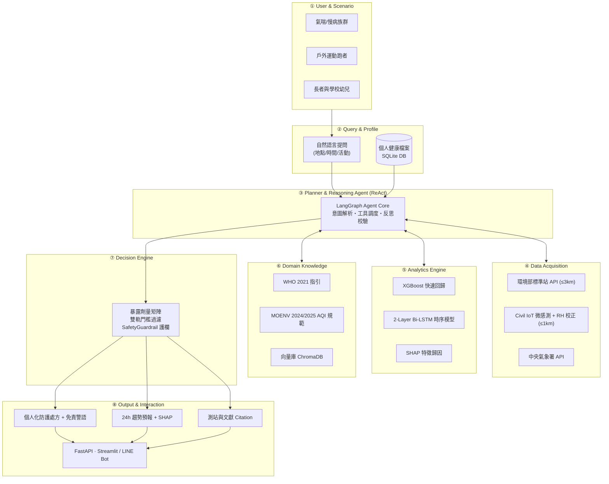
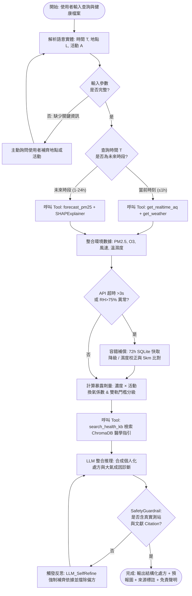
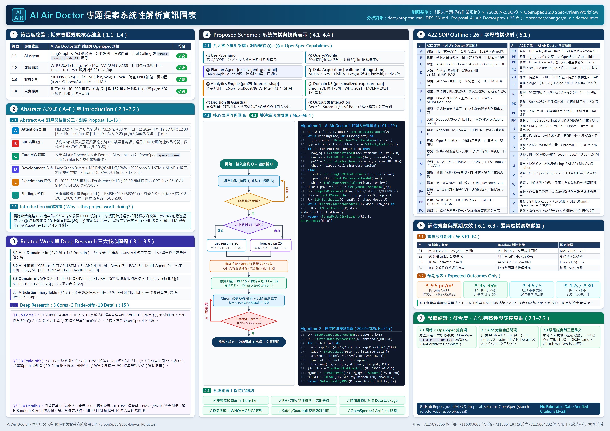

# AI Air Doctor: 結合 IoT 空品數據與環境醫學知識的個人化空氣品質健康代理人

**AI Air Doctor: A Domain AI Agent for Personalized Air-Quality Health Advisory Integrating IoT Sensing and Environmental Medicine Knowledge**

組員：7115093066_楊禾睿、7115093063_徐崇皓、7115064183_謝秉樺、7115064202_譚人傑  
課程：物聯網與智慧系統應用專題（OpenSpec Refactor 版）  指導教授：陳煥 教授

---

## 1. Abstract 摘要

**(A) Attention Getter — Motivation**  
根據世界衛生組織（WHO）與 Health Effects Institute（HEI）於 2025 年發布的《State of Global Air 2025》報告，空氣污染仍是全球第二大早逝風險因子（僅次於高血壓），於 2023 年造成全球約 **790 萬人死亡**（約佔全球死亡人數八分之一），其中室外 PM2.5 導致 **490 萬人早逝**，且 86% 死亡來自心血管疾病、中風與慢性呼吸道疾病等非傳染性疾病 [1]。在台灣，雖然環境部統計全國 PM2.5 年均濃度已降至 2024 年的 **12.8 μg/m³**，並於 2024 年 9 月加嚴國家空氣品質標準（PM2.5 年均 15→12 μg/m³、日均 35→30 μg/m³，2025 年起連動調整 AQI 警戒門檻）[3]，但西半部及中南部在秋冬季節受東北季風與中央山脈背風面逆溫滯留影響，區域 PM2.5 仍頻繁超過警戒，對全台估計約 **140 至 200 萬名氣喘潛在與確診患者** [21]、慢性阻塞性肺病（COPD）長者及戶外運動族群構成顯著威脅；2025 年一項橫跨 152 萬名成人的大型統合研究更證實，當長期 PM2.5 暴露超過 25 μg/m³ 時，規律運動降低死亡率的保護效益將由約 30% 銳減至 12%–15% [16]。

**(B) But — Challenge & Research Gap**  
然而，現有監測與諮詢方案存在三大斷層：(1) 官方監測 App（如環境即時通）僅展示單點即時 AQI 數值與顏色警報，未整合個人病史與運動換氣量差異；(2) 傳統以 LSTM、XGBoost 或 Geo-AI 為主的空污預測研究多專注於數值誤差指標，缺乏面向大眾的生活行動轉譯與大氣成因解釋；(3) 通用大型語言模型（LLM）缺乏即時在地感測連線與臨床實證檢驗，容易產生醫療建議幻覺。學界與實務界仍缺乏能將**即時雙層 IoT 感知、24 小時可解釋預報與個人化臨床 RAG 護欄**結合於單一規格驅動（Spec-Driven）系統的 Domain AI Agent。

**(C) Cure — Proposed Solution**  
為了解決上述問題，本專題提出一個新的 **AI Air Doctor（空品健康智囊）** 領域智慧代理人系統（Domain AI Agent），並採用 **OpenSpec（Spec-Driven Development）** 工作流定義完整規格、技術決策與驗證標準。

**(D) Development — Method**  
系統以 LangGraph ReAct 狀態機為核心調度架構，串接四大規格化能力模組：(1) **即時多源感知（`realtime-iot-ingestion`）**：以環境部標準測站（半徑 3 公里基準）結合民生公共物聯網（Civil IoT）微型感測器（半徑 1 公里高密度感知，異常時擴展至 5 公里比對）與中央氣象署觀測，並對高濕度（RH > 75%）之光散射誤差進行物理／演算法補償及 3 秒超時 72 小時 SQLite 離線快取降級；(2) **趨勢預報與歸因（`pm25-forecast-shap`）**：採用嚴格時間滾動切分訓練 **XGBoost** 與 **雙向 LSTM** 雙軌模型（依 RMSE 擇優），預測未來 1–24 小時 PM2.5 濃度與 95% 信賴區間，並以 **SHAP** 解析風場與逆溫成因；(3) **暴露劑量與醫學 RAG（`personalized-exposure-rag`）**：依據靜態（×1.0）至劇烈跑步（×1.8）換氣係數計算暴露劑量，敏感族群自動切換為 WHO 2021 嚴格門檻（24h 15 μg/m³），透過 ChromaDB 檢索臨床指引；(4) **安全護欄與反思（`react-agent-guardrail`）**：強制檢查測站與文獻來源引用（未通過即觸發自我反思修正），並於本機 SQLite 保存健康檔案以確保隱私。

**(E) Experiments — Evaluation**  
系統驗證分為四組實驗：**E1** 以台灣環境部 2022–2025 年逐時資料集（2025 年作為純盲測集）對比 Persistence 基準與多元線性回歸，評估 1h/6h/24h 的 MAE、RMSE 與 R²；**E2** 以 30 組經臨床審核設計之脆弱族群情境，對比無工具 GPT-4o 與無時序預測之純 RAG，評估醫學指引對齊率與幻覺率；**E3** 針對 10 場台灣典型高污染事件評估 SHAP 成因歸因與專家診斷之一致性；**E4** 進行 100 次並行自然語言請求之端到端延遲與 SUS 系統易用性評估。

**(F) Findings — Expected Outcomes**  
（嚴格遵循「未實驗者僅列 Expected Outcomes，不虛構數據」）：預期 **AI Air Doctor** 在 24 小時 PM2.5 預測之 RMSE 可較 Persistence 基準降低 35% 以上（預期 ≤ 9.5 μg/m³，6 小時 R² ≥ 0.82）；在 30 組個人化健康情境下達成 **≥ 95%–96%** 臨床指引對齊率、**≤ 2%–3%** 幻覺率與 **100% 可追溯數據／文獻引用**；端到端回應延遲維持於 **≤ 4.2 秒**（95% 請求 ≤ 5 秒，SUS ≥ 80），實現「懂大氣與環境醫學、會取即時數據、能定量預測、有嚴謹依據」的 Domain AI Agent。

---

## 2. Abstract（摘要）與 Introduction（緒論）結構對照

為確保摘要與緒論敘事邏輯一致並符合專題規範，以下呈現 **Abstract 六段式（A–F）重點摘要** 與 **Abstract A–F ↔ Introduction A–F 結構對照表**：

### 2.0 Abstract 六段式（A–F）對照總覽
* **A. Attention Getter**：引用 HEI《State of Global Air 2025》全球 790 萬空污早逝（室外 PM2.5 佔 490 萬、86% 源於非傳染性疾病）[1]、台灣 2024 年 PM2.5 年均 12.8 μg/m³ 與環境部 2024/09 修訂標準（年均 12 / 日均 30 μg/m³）[3]、約 140–200 萬氣喘族群 [21]，以及中興大學 152 萬人研究證實 PM2.5 ≥ 25 μg/m³ 使運動保護力減半 [16] 引題。
* **B. But（挑戰）**：現有官方 App 僅顯示單點數值、缺乏個人暴露劑量與前瞻時序預報；傳統 ML 研究缺語意轉譯；通用 LLM 缺乏即時台灣 IoT 感測與實證醫學護欄易生幻覺，且低成本微感測器於 RH > 75% 未校正易虛高 [9–15, 20]。
* **C. Cure（解藥）**：提出 **AI Air Doctor** 個人化領域智慧代理人（Domain AI Agent），並採用 OpenSpec 規格驅動開發架構。
* **D. Development（方法）**：整合 LangGraph ReAct 編排、MOENV（3 km）+ Civil IoT（1 km、RH > 75% 校正、72h SQLite 快取）+ CWA 氣象、雙軌 XGBoost / 2-Layer Bi-LSTM 24h 預報 + SHAP 歸因、活動換氣暴露係數 × 雙軌門檻（WHO 2021 vs MOENV 2024）、ChromaDB 臨床 RAG 與 `SafetyGuardrail` 反思驗證 [2–8, 17–23]。
* **E. Experiments（評估）**：規劃台灣環境部 2022–2025 逐時資料集（2025 盲測）對比 Persistence／線性回歸（E1）、30 組臨床醫師審核案例對比原始 GPT-4o 與純 RAG（E2）、10 場歷史紅害事件 SHAP 專家一致度評核（E3），以及 100 次並行請求延遲與 SUS 問卷評估（E4）。
* **F. Findings（預期產出）**：嚴格遵循「未實驗者僅列 Expected Outcomes，不虛構數據」，預期達成 24h PM2.5 預測 RMSE ≤ 9.5 μg/m³（較基準降 35%+，6h R² ≥ 0.82）、臨床指引對齊率 ≥ 95%–96%、幻覺率 ≤ 2%–3%、100% 來源引用追溯、平均回應 ≤ 4.2s（95% ≤ 5s）與 SUS ≥ 80。

### 2.1 Abstract（A–F）↔ Introduction（A–F）映射對照表

| Abstract 六段式 | 對應 Introduction 章節 | 核心問題意識與敘事分工 | 關鍵客觀依據與引用 |
| :--- | :--- | :--- | :--- |
| **A. Attention Getter** | **3.1 A. Attention Getter** | Abstract 以統計數據快速點題；Introduction 展開全球死亡負擔、台灣季風逆溫地理脈絡與脆弱族群需求。 | HEI 2025 [1]、WHO 2021 [2]、MOENV 2024 [3]、Ku et al. 2025 [16]、TSPCCM [21] |
| **B. But（挑戰）** | **3.2 B. Background** / **3.3 C. Problem** / **3.4 D. Limitations** | Abstract 濃縮現況三大斷層；Introduction 補齊台灣 IoT 基礎建設、以氣喘晨跑情境定義四大技術支柱，並表列拆解既有四類系統瓶頸。 | MOENV/Civil IoT/CWA [3–6]、LLM/Geo-AI 文獻 [9–15]、Hua et al. 2021 [20]、Daigle et al. 2003 [23] |
| **C. Cure（解藥）** ＋ **D. Development（方法）** | **3.5 E. Innovation** | Abstract 揭示 AI Air Doctor 解法與八模組／OpenSpec 四大能力；Introduction E 提煉四項相較既有研究之差異化創新點。 | ReAct [7]、RAG [8]、OpenSpec (`openspec/changes/ai-air-doctor-mvp/`) |
| **E. Experiments（評估）** ＋ **F. Findings（預期產出）** | **3.6 F. Contributions** | Abstract 定義 E1–E4 量化實驗與不虛構之預期驗證目標；Introduction F 收斂架構、技術、知識與應用四大專題貢獻。 | 統一對齊 `DESIGN.md` §11 與 OpenSpec `design.md` 驗證計畫 |

### 2.2 《2020 A-Z SOP》全結構映射總表（A–Z 暨 PA–PM）

依循課程附件《A2Z outline example.pdf》（2020 A-Z SOP），本專題將全篇結構（`A–F` 摘要、`G–L` 緒論、`M–O` 文獻、`PA–PM` 系統設計、`Q–V` 實驗評估、`W–Z` 結論交付）完整落實對應如下（完整逐字母深析詳見 [AI_Air_Doctor_Proposal_Analysis.md](AI_Air_Doctor_Proposal_Analysis.md)）：

| A2Z 區段 | 字母範圍 | A2Z SOP 核心任務 | AI Air Doctor 落實與章節／OpenSpec 對應 |
| :--- | :---: | :--- | :--- |
| **Abstract** | **A–F** | 引題 → 挑戰 → 解藥 → 方法 → 評估 → 預期成果 | §1 (A–F) 與 §2.0；嚴格區分 E1–E4 Expected Outcomes，絕不虛構數據。 |
| **Introduction** | **G–L** | 現況背景 → 深層瓶頸 → 文獻演進 → 優劣評析 → 核心設計 → 全文導覽 | §3.1–§3.6；80+ MOENV + 上萬 Civil IoT + CWA [3–6]，對比四類方案並條列四大貢獻。 |
| **Related Work** | **M–O** | 方法分類（1/2 AI + 1/2 Domain）→ 創新技術 → 比較總表與缺口收斂 | §4.1–§4.4；23 篇查證文獻＋§4.3 8 篇 2024–2026 Article Summary Table 收斂 Research Gap。 |
| **Proposed Scheme** | **PA–PM** | 目標（PA）· 基礎（PB）· 成因（PC）· 典範轉移（PD）· 模組（PE）· 公式（PF）· 圖表（PG）· 實作（PH–PI）· 實例（PJ）· 貢獻（PK）· 模擬（PL）· 邏輯不變式（PM） | §6.1–§6.4；①–⑧ 模組對應 OpenSpec 4 Capabilities；Dose/風(u,v)/ΔT 公式、雙圖、`Algo 1 & 2` 行號虛擬碼與 `TimeBasedRollingSplit` 防漏不變式。 |
| **Simulation / Eval** | **Q–V** | 評估指標（Q）· 比較基準（R）· 實驗環境（S）· 調參（T）· 產出（U）· 驗證（V） | §6.5 E1–E4；對比 Persistence/GPT-4o/純 RAG/無 SHAP，達成 RMSE ≤ 9.5、對齊 ≥ 95–96%、幻覺 ≤ 2–3%、SUS ≥ 80。 |
| **Conclusion** | **W–Z** | 回顧總結（W）· 專精優勢（X）· 交付物（Y）· 反思展望（Z） | §6.6、`DESIGN.md` §12；專精台灣高濕與逆溫預警，交付 GitHub + OpenSpec + 22 頁簡報，預留無 CO₂ 感測推估之擴充點。 |

---

## 3. Introduction 緒論

Why is this project worth doing? 本章依循 **A–F 結構**，與上述摘要六段式嚴密呼應，從客觀公衛證據、台灣監測基礎建設、真實生活決策痛點到本專題之工程與方法創新，完整論證 **AI Air Doctor** 的必要性與技術價值。

### 3.1 A. Attention Getter（動機與客觀證據）
空氣污染已被證實為當代最嚴峻的可預防環境健康風險之一。根據 Health Effects Institute（HEI）與 IHME 合作的《State of Global Air 2025》報告，2023 年全球約有 **790 萬人**因空氣污染早逝（佔全球總死亡人數約八分之一），躍居全球第二大死亡風險因子，其中室外 PM2.5 單一項目即造成 **490 萬人**死亡，且高達 **86%** 的相關死亡源於缺血性心臟病、中風、慢性阻塞性肺病（COPD）與肺癌等非傳染性疾病 [1]。世界衛生組織（WHO）亦於 2021 年大幅收緊全球空氣品質指引，將 PM2.5 年均與 24 小時建議值分別定為 **5 μg/m³** 與 **15 μg/m³** [2]。

在台灣情境下，雖然環境部推動空污防制使全國 PM2.5 年均濃度由 2016 年約 20 μg/m³ 穩步降至 **2024 年的 12.8 μg/m³**，並於 **2024 年 9 月 30 日**正式加嚴《空氣品質標準》（將 PM2.5 年均限值從 15 下修至 **12 μg/m³**、24 小時限值從 35 下修至 **30 μg/m³**，自 2025 年起連動調整 AQI 預警門檻）[3]，但季節性與地形性污染落差依然顯著：每年秋冬東北季風南下配合中央山脈背風面沉降與夜間輻射逆溫，導致中南部地區短期小時與日均濃度仍頻繁跨越敏感族群警戒。依據衛福部國健署與台灣胸腔暨重症加護醫學會統計，台灣成人氣喘盛行率約 **10%–12%**、兒童及青少年達 **15%–20%**，全台推估約有 **140 至 200 萬名**受氣喘影響之人口 [21]。同時，國立中興大學研究團隊主導、發表於 *BMC Medicine*（2025）的 **152 萬人跨國世代統合分析**指出，當環境 PM2.5 年均濃度達 **25 μg/m³ 以上**時，規律運動帶來的全因死亡率保護效益將由約 30% 減半至 12%–15%，若達 **35–50 μg/m³** 更可能大幅削弱防護效果 [16]。這意味著民眾需要的不再只是「靜態達標數據」，而是能與個人運動強度及健康風險即時連動的智慧決策支援。

### 3.2 B. Background（應用、使用者與技術背景）
台灣在智慧環境感測方面具備極佳的開放資料條件：環境部（MOENV）於全台部署超過 **80 座**法規級空氣品質自動測站，每小時釋出 PM2.5、PM10、O₃、NO₂、SO₂、CO 與 AQI [3]；國家科學及技術委員會與環境部共同推動的**民生公共物聯網（Civil IoT Taiwan）**更於社區、校園與工業區周邊部署上萬顆微型空氣感測器（如 AirBox），透過 SensorThings API 提供約 5 分鐘級的高密度微環境觀測 [4, 5]；交通部中央氣象署（CWA）亦開放逐時風速、風向、氣溫、相對濕度與降雨資料 [6]。在軟體工程與 AI 技術面，大語言模型已從純對話生成演進至 **ReAct** 工具調用 [7]、**RAG** 實證檢索 [8] 與 **MCP（Model Context Protocol）** 等標準化代理人架構 [10]；配合 **OpenSpec（Spec-Driven Development）** 規格驅動開發流程，讓跨模組 AI 系統能以明確的需求規格（`specs`）、技術權衡（`design`）與可驗證任務清單（`tasks`）進行嚴謹交付。

### 3.3 C. Problem（核心問題定義）
民眾面對空氣品質資訊時，真正關切的問題並非抽象的化學濃度數字，而是具體的個人化生活決策，例如：
> 「我今年 65 歲患有慢性氣喘，明天早上 7 點想去大安森林公園慢跑 5 公里適合嗎？家裡窗戶該何時打開換氣？」

要可靠地回答這個問題，系統必須同時打通四道技術關卡，缺一不可：
1. **即時微環境感知**：兼顧環境部標準站精度與周邊 Civil IoT 微型感測器之高空間解析度，並排除高濕度造成的光散射誤差 [15, 20]。
2. **前瞻時序預報與成因解釋**：預測明天清晨 07:00（而非僅看當下或昨天）之 PM2.5 趨勢，並辨識是否受輻射逆溫與弱風滯留影響 [14]。
3. **個人化生理暴露換算**：考量慢跑時成人每分鐘通氣量由靜止 **6–8 L/min** 暴增至 **50–100+ L/min**（8–15 倍，溫和運動亦使肺部總微粒沉積量較靜息高出 4.5 倍以上）且轉為口呼吸失去鼻腔過濾之生理事實，將環境濃度轉化為個體吸入暴露風險 [16, 23]。
4. **可驗證環境醫學指引**：依個體脆弱度套用 WHO 2021 或台灣 AQI 雙軌門檻，產出附帶明確測站與醫學指引出處之建議，杜絕未經實證的民間偏方或醫療幻覺 [2, 8]。

### 3.4 D. Existing Limitations（現有方法瓶頸）

| 現存方案類別 | 代表系統／研究 | 具備能力 | 主要限制與技術瓶頸 |
| :--- | :--- | :--- | :--- |
| **官方空品監測 App** | 環境即時通、AirVisual | 顯示即時與歷史單點 AQI | 僅被動廣播一般性顏色分級，無未來逐時個人化預測，亦無法依氣喘與運動強度換算暴露劑量。 |
| **機器學習預測研究** | Geo-AI、XGBoost、LSTM [14, 19] | 高精度 PM2.5 數值估計／回歸 | 偏重 RMSE/R² 評估，輸出缺乏自然語言互動、氣候因果敘事與臨床防護處方轉譯。 |
| **通用生成式 AI** | 原始 ChatGPT、Claude | 強大對話理解與文字生成 | 無法存取即時台灣 IoT 測站與個人檔案，且醫療實證約束不足，易產生捏造建議之安全幻覺。 |
| **近年空品 LLM 研究** | Policy Agent、MCP/Alert Agent [9–12] | 工具串接、政策草案或局部警報 | 多聚焦宏觀災難政策 [9]、純即時監測 [10, 11] 或純預測 [12]，缺少台灣在地高濕校正、24h 預報與雙軌醫學 RAG 護欄之整合。 |

### 3.5 E. Innovation（本專題創新點）
1. **感測＋預測＋臨床 RAG 三維閉環架構**：以 LangGraph ReAct 統一調度「雙層 IoT 即時感知」、「雙軌 ML 24 小時預報 + SHAP 歸因」與「ChromaDB 環境醫學 RAG」，補足現有單點研究缺口。
2. **高濕校正與雙層空間感知機制**：結合環境部 3 公里標準站基準與 Civil IoT 1 公里微感測網，並於 RH > 75% 時啟動光散射吸濕膨脹校正與 5 公里離群比對，解決台灣亞熱帶高濕環境下的感測失真痛點 [15, 20]。
3. **動態暴露劑量與雙軌風險門檻引擎**：依據活動換氣係數與個人病史自動切換一般（MOENV 2024/2025）與敏感族群（WHO 2021）門檻，實現精準分級防護。
4. **強制引用護欄（`SafetyGuardrail`）與 OpenSpec 規格驅動工程**：任何回答未涵蓋測站編號、預測信賴狀態或醫學出處即觸發自我反思重寫；全專案以 OpenSpec `proposal → specs → design → tasks` 鎖定可測試需求場景與交付品質。

### 3.6 F. Contributions（預期專題貢獻）
* **工程與規格貢獻**：將系統架構全面轉換為 OpenSpec `spec-driven` 工作流（涵蓋 4 項可驗證能力規格、技術權衡決策與任務清單），搭配 [DESIGN.md](../DESIGN.md) 建立完整工程移交規範。
* **技術貢獻**：建立整合風向正交分解 (u, v)、日夜週期與逆溫潛勢的台灣在地時序特徵管線，實作 XGBoost／雙向 LSTM 24 小時預測與 SHAP 大氣成因診斷。
* **知識貢獻**：結構化整理 WHO 2021 指引、台灣 MOENV 2024/2025 修正標準、胸腔重症醫學會氣喘照護指引與室內通風 CADR 手冊，建立可追溯向量知識庫。
* **應用貢獻**：提供具備 Streamlit 儀表板與 LINE Bot 介面的可重現開源架構，協助氣喘、長者與戶外運動者做出即時且有科學依據的健康防護決策。

---

## 4. Related Work 相關研究

本章遵循 **「約 1/2 AI Technology + 1/2 Domain Know-how」** 原則，所有引用文獻均經原始來源與識別碼（arXiv ID / DOI）查證核實。

### 4.1 AI Technology（AI 模型、時序預測與代理人架構）
* **可解釋機器學習與時序預測**：在非線性大氣回歸任務中，Chen & Guestrin [17] 提出之 XGBoost 具備優良的表格式氣象特徵擬合效率；Lundberg & Lee [18] 提出之 SHAP（SHapley Additive exPlanations）則能將複雜模型預測拆解為各氣象因子的邊際貢獻。針對台灣地形污染特性，Yin et al. [19] 驗證整合氣象與週期特徵之機器學習集成框架可提升埔里盆地 PM2.5 預測精度；Wong et al. [14] 進一步結合 Geo-AI 集成學習與 SHAP，解析台灣通勤尖峰時段 PM2.5 時空變異的關鍵驅動因子。近年亦出現結合大語言模型進行氣象驅動空污預測之研究，例如 Dey et al.（2026）提出 `GPT4AP` [12]，展現跨污染物質在資料稀缺情境下的多任務預報潛力。
* **LLM Agent、MCP 與實證醫學 RAG**：Yao et al. [7] 提出 ReAct 範式使 LLM 能透過「思考—行動—觀察」調用外部工具；Lewis et al. [8] 提出 RAG 檢索外部文獻以抑制生成幻覺。於醫療領域，Yu et al. [13] 提出 `Health-LLM`，結合特徵提取、醫學知識權衡評分與 RAG 進行個人化疾病預測。於空品智慧應用前沿，Gao et al.（2025）建立 **Instructor–Worker 多代理人 LLM 系統**分析 2025 年洛杉磯野火空氣品質並輔助政策建議 [9]；Pan & Nipu（2025）導入 **Model Context Protocol（MCP）** 建構空品監測介面，讓 LLM 主動呼叫即時感測工具以大幅降低幻覺 [10]；Vieira et al.（2026）則發表 `EnQyMo` 平台結合代理型 LLM 與環境感測串流產出在地化空品警報 [11]。

### 4.2 Domain Know-how（環境大氣物理、感測校正與環境醫學）
* **國際指引與台灣法規演進**：WHO（2021）根據全球世代研究將 PM2.5 24 小時指引收緊至 15 μg/m³、年均定為 5 μg/m³，並強調極低濃度下仍存在健康風險 [2]。台灣環境部於 2024 年 9 月修正《空氣品質標準》，將 PM2.5 年均限值從 15 下修至 12 μg/m³、日均限值從 35 下修至 30 μg/m³，並改採「站站達標」與連動下修 AQI 門檻 [3]。
* **微型感測器高濕吸濕偏差與校正**：台灣雖透過 Civil IoT 建置高密度微型感測網 [4, 5]，但無加熱除濕裝置的低成本光散射感測器（如 PMS5003）在亞熱帶高濕環境面臨嚴重挑戰。Jayaratne et al.（2018）與 Hua et al.（2021）證實當環境相對濕度（RH）超過 **75%** 時，水溶性氣膠發生吸濕成長（Hygroscopic Growth），會導致光散射讀值相較重量法標準站大幅虛高 [20]；Jung et al.（2026）近期整合台灣上千座低成本感測器與衛星光學厚度建立高解析 PM2.5 模型，亦再次指出相對濕度是最核心的校正特徵之一 [15]。
* **運動通氣生理劑量與室內認知權衡**：人體吸入微粒總量取決於環境濃度、暴露時間與每分鐘通氣量（Minute Ventilation, V̇_E）。成年人靜止時 V̇_E 約 **6–8 L/min**，劇烈跑步可飆升至 **50–100+ L/min**（8–15 倍），且因轉為口呼吸而使微粒繞過鼻腔過濾直達下呼吸道；Daigle et al.（2003）亦實測證實即使溫和運動（V̇_E ~38.1 L/min 相較靜息 ~9.0 L/min），呼吸道微粒總沉積負荷仍較靜息高出 **4.5 倍以上** [23]。Ku et al.（2025）於 *BMC Medicine* 彙整涵蓋台灣在內 **152 萬名成人**的跨國世代資料，明確量化指出 PM2.5 ≥ **25 μg/m³** 會使運動降低死亡率的保護幅度減半 [16]。另一方面，室內防護亦非「永遠密閉」即可解決：Allen et al.（2016）與相關 ASHRAE 室內環境研究顯示，密閉空間內當二氧化碳（CO₂）累積至 **1,000–1,400+ ppm**（相較乾淨基準 ~550 ppm）時，受試者在決策與資訊處理等多項高階認知能力便已顯著下降 [22]。

### 4.3 Article Summary Table（經查證之核心文獻對比表，4 篇 AI + 4 篇 Domain/跨領域）

| Ref | Year | Problem | AI Method | Domain Knowledge | Dataset | Findings | Limitation / Gap |
| :---: | :---: | :--- | :--- | :--- | :--- | :--- | :--- |
| **[9]** | 2025 | 2025 洛杉磯野火期間空品分析與公衛政策建議 | Instructor-Worker 多代理人 LLM + GIS 雲端查詢 | 野火煙霧擴散、空品健康風險與政策分級 | 2025 LA 野火期間空間／環境監測資料 | 多代理協作能自主調度資料並產出空品風險與政策通報 | 偏宏觀政策與災情回顧，缺乏個人病史換算與未來 24h 在地預報 |
| **[10]** | 2025 | 一般民眾難以解讀即時空品感測介面與指標 | LLM + Model Context Protocol (MCP) Server | PM2.5 / PM10 / VOCs 危害與安全通訊規範 | 即時環境與空品感測資料串流 | 透過 MCP 工具化調用顯著降低安全敏感領域的 LLM 幻覺 | 以即時狀態查詢為主，缺少 24h 時序預測模型與醫療指南 RAG |
| **[11]** | 2026 | 環境感測串流與專業文獻對非專家門檻高 | 代理型 LLM + 檢索機制（EnQyMo 平台） | 污染濃度閾值與慢性呼吸道風險關聯 | 環境品質感測站數據與科學文獻 | 能自動結合法規文獻與即時感測生成在地化預警通知 | 未針對台灣高濕微型感測器校正，亦無運動換氣劑量動態加權 |
| **[12]** | 2026 | 資料稀缺地區之多污染物空品預測精度受限 | 氣象驅動多任務微調 LLM（GPT4AP） | 氣象變因與大氣污染物跨物種關聯 | 多區域氣象與大氣污染觀測資料集 | 善用氣象條件先驗提升跨站點、跨污染物預報遷移能力 | 屬於純數值預報模型，未整合 SHAP 大氣成因解釋或臨床防護互動 |
| **[13]** | 2024/25 | 通用 LLM 應用於個人化疾病預測準確度與可信度不足 | 特徵提取 + 知識權衡評分 + RAG（Health-LLM） | 臨床疾病風險因子與個人健康報告語意 | 個人化醫療檢驗報告與臨床知識庫 | RAG 與領域權衡評分顯著提升個人疾病風險預測之準確性 | 缺乏即時外部 IoT 環境感測與空間氣象擴散特徵接入 |
| **[14]** | 2024 | 台灣通勤尖峰時段 PM2.5 時空高變異估計與成因解析 | Geo-AI 堆疊集成學習 + SHAP 可解釋框架 | 台灣交通排放、土地利用與微氣象擴散動力 | 台灣空品測站與地理空間環境特徵資料 | 成功量化不同氣象與空間變因對通勤尖峰 PM2.5 之貢獻度 | 為空間濃度估計研究，缺乏對話式 Agent 介面與個人健康處方生成 |
| **[15]** | 2026 | 台灣高密度微型感測器高濕誤差與高解析空品建模 | 機器學習融合校正模型（含相對濕度補償） | 光散射氣膠吸濕成長機制與衛星 AOD 融合 | 台灣數千座低成本感測網與衛星觀測 | 納入相對濕度等氣象因子後大幅改善微型感測與標準站一致性 | 聚焦於高解析網格製圖研究，未提供前瞻 24h 個人防護建議服務 |
| **[16]** | 2025 | 空氣污染環境下從事戶外休閒運動的健康淨效益權衡 | 系統性回顧、統合分析與個體資料匯集模型 | 運動生理效益、PM2.5 暴露劑量與死亡風險 | 橫跨台、英、美、丹、中等 7 世代（152 萬人） | 年均 PM2.5 ≥ 25 μg/m³ 使運動降死亡效益由 30% 減半至 12–15% | 提供大型流行病學實證閾值，需透過智慧 Agent 落實至日常排程 |

### 4.4 Summary（現有研究收斂與本專題切入點）

`Existing Research ──> Limitations ──> Research Gap ──> Our Project`

* **現有研究進展**：前端大氣 AI 已能在台灣場域透過 Geo-AI/XGBoost/LSTM 與 SHAP 解析污染成因 [14, 15, 19]，流行病學亦明確量化 PM2.5 與運動風險的劑量閾值 [16]；後端 LLM 領域亦已透過 MCP、RAG 與多代理人架構降低對話幻覺 [9–11, 13]。
* **核心缺口（Research Gap）**：至今仍缺乏一個**專為台灣氣候與監測網設計，能同時串接「MOENV + RH 校正後 Civil IoT 雙層即時感知」、「嚴格時間切分之 24h 預報與 SHAP 歸因」、「依個人病史與運動換氣量切換雙軌門檻之暴露計算」以及「具強制來源護欄的環境醫學 RAG」之端到端 Domain AI Agent**。
* **本專題定位**：**AI Air Doctor** 正是填補此缺口的具體解決方案，並以 OpenSpec 規格驅動工程落實每個需求與測試情境。

---

## 5. Deep Research：三大核心問題（5 Cores, 3 Trade-offs, 10 Details）

本章依據專業領域深度研究架構，完整定義與剖析本專題之 **5 Cores（五個核心思維模式）**、**3 Trade-offs（三個核心爭論與工程權衡）** 及 **10 Details（十個深度理解問題）**。

### 5.1 Q1. 五個核心思維模式（5 Cores）

1. **Core 1：暴露劑量不等於環境濃度（Dose ≠ Ambient Concentration）**
   * **意義**：測站測得的是大氣濃度（μg/m³），但決定人體肺泡發炎程度的關鍵是實際吸入沉積劑量（Dose = C × V̇_E × T）。
   * **科學證據**：成年人靜坐時每分鐘通氣量 V̇_E 約 **6–8 L/min**，劇烈跑步時可激增至 **50–100+ L/min**（約 **8–15 倍**），且因改採口呼吸而繞過鼻腔纖毛過濾；Daigle et al.（2003）實測運動使總微粒沉積負荷高出靜息 **4.5 倍以上** [23]，Ku et al.（2025）152 萬人世代分析亦證實高濃度 PM2.5（≥ 25 μg/m³ 與 35–50 μg/m³）會大幅抵消戶外運動的健康效益 [16]。
   * **系統與 OpenSpec 設計影響**：在 `personalized-exposure-rag` 規格中設計活動強度係數（靜態 `1.0`、劇烈跑步 `1.8`）動態加權計算有效暴露劑量，作為風險分級輸入，而非僅用原始環境濃度。

2. **Core 2：敏感族群無絕對安全閾值（No Safe Threshold for Vulnerable Populations）**
   * **意義**：即使環境數值符合一般民眾標準，對氣喘、COPD、心血管疾病患者、長者與孕婦仍可能誘發急性氣道高反應性與全身性血管發炎。
   * **科學證據**：WHO 2021 全球空氣品質指引明確指出 PM2.5 在極低濃度區間仍與心肺疾病死亡率呈現無安全閾值的暴露反應關係，因此將 24 小時建議值定為嚴格的 **15 μg/m³** [2]；台灣約有 **140–200 萬名**受氣喘影響族群 [21]，風險耐受度遠低於健康成人。
   * **系統與 OpenSpec 設計影響**：在 `personalized-exposure-rag` 規格中建立雙軌門檻：偵測到 SQLite 本機檔案含敏感病史時，自動由一般門檻（≤30/50/70/>70 μg/m³）切換為嚴格 WHO 2021 門檻（≤15/30/50/>50 μg/m³）。

3. **Core 3：微環境時空異質性與感測物理邊界（Micro-environmental Heterogeneity & Sensor Physics）**
   * **意義**：受道路峽谷效應、車流與局地排放影響，數公里外的大型測站未必能反映巷弄微氣候；但高密度的低成本光散射微型感測器又極易受水氣干擾而產生偏差。
   * **科學證據**：Jayaratne et al.（2018）與 Hua et al.（2021）證實當環境相對濕度 **RH > 75%** 時，親水性氣膠吸水膨脹（Hygroscopic Growth）使無加熱光散射感測器明顯高估真實乾重 PM2.5 [20]；Jung et al.（2026）研究台灣 Civil IoT 微感測網時亦將 RH 列為首要氣象校正因子 [15]。
   * **系統與 OpenSpec 設計影響**：在 `realtime-iot-ingestion` 規格採取「**3 公里環境部標準站基準 + 1 公里 Civil IoT 微型感測加權**」雙層架構，並強制於 RH > 75% / > 85% 時執行濕度補償與 5 公里標準站離群比對。

4. **Core 4：大氣動力學非線性主導污染演變（Atmospheric Dynamics Predominance）**
   * **意義**：短期高污染警報爆發多數不是排放源突然增加，而是邊界層高度下降、輻射逆溫壓制垂直對流與靜風導致擴散停滯。僅監測污染物本身屬被動滯後，必須同步掌握氣象動力場。
   * **科學證據**：台灣西部平原與盆地地形於秋冬受背風面弱風與夜間輻射逆溫影響顯著；Wong et al.（2024）以 SHAP 解析台灣通勤時段 PM2.5 時亦證實氣象與風場擴散條件為核心解釋變因 [14]。
   * **系統與 OpenSpec 設計影響**：在 `pm25-forecast-shap` 規格嚴格納入風向正交分解 (u, v)、日夜週期 sin/cos 與逆溫潛勢指標 ΔT = T_surface - T_dewpoint，並以 `SHAPExplainer` 產出前三大氣象因果歸因。

5. **Core 5：前瞻預警時間價值遠大於事後確認（Proactive Lead-Time > Reactive Confirmation）**
   * **意義**：一旦感受到刺鼻感或收到超標通知，懸浮微粒已進入下呼吸道造成氧化壓力；關窗、啟動 HEPA 清淨機或調整運動時段必須在污染高峰來臨前預先執行。
   * **科學證據**：室內外微粒滲透具有時間延遲特性，且運動前改期或於離峰擴散佳的時段進行通風換氣，方能有效壓低累積暴露劑量並避免運動護心效果受損 [16]。
   * **系統與 OpenSpec 設計影響**：在 `react-agent-guardrail` 規格將「時態路由」設為核心節點——凡查詢未來時段（1–24 小時）強制調度預測模型與 SHAP，主動標示安全活動或脈衝開窗時間窗口。

---

### 5.2 Q2. 三個最重要的專業爭論與系統權衡（3 Trade-offs）

嚴格依據 **觀點 A ↔ 觀點 B → Evidence → Consensus → Unresolved Problems → 本專案權衡（OpenSpec Mapping）** 架構剖析：

#### Trade-off 1：低成本光散射微型感測器（空間密度）vs. 高濕度誤差（量測準確度）
* **觀點 A（高密度感知派）**：Civil IoT 微型感測器成本低、全台布點上萬顆 [4, 5]，能補齊大型標準站（約 80 餘座）之間的空間盲區，捕捉鄰近道路與社區的污染熱點。
* **觀點 B（標準站品管派）**：無加熱除濕器的光散射感測器在高濕環境極易將吸濕膨脹的水氣氣膠誤判為高濃度微粒，且戶外長期日曬積塵易致零點漂移，直接採用容易製造虛假紅色警報。
* **Evidence（實證依據）**：Hua et al.（2021）與 Jayaratne et al.（2018）實驗證實 RH 超過 **75%** 後光散射讀值出現非線性暴衝 [20]；Jung et al.（2026）整合台灣數千座微感測器與氣象／衛星特徵訓練校正模型後，大幅拉近與標準站的吻合度 [15]。
* **Consensus（學界與實務共識）**：微型感測器絕不取代法規標準站作為環保稽查開罰依據，但在「結合氣象溫濕度非線性校正與標準站鄰近比對」下，適合作為社區微環境趨勢與預警輔助。
* **Unresolved Problems（未解難題）**：上萬顆戶外感測器各自老化與積塵速率不同，如何在無需人工逐一現場標定的前提下，建立長期雲端線上自動漂移偵測與衰退校正協議。
* **本專案 OpenSpec 權衡（`realtime-iot-ingestion`）**：採用雙層架構，平時取 1 公里內微感測器提供高解析感知，一旦 RH > 75%（尤其 > 85%）立即啟動校正權重並交叉比對 5 公里內環境部標準站以剔除水氣假峰值。

#### Trade-off 2：室外紅害防滲透密閉（阻絕 PM2.5）vs. 室內通風換氣（防止 CO₂ 認知衰退）
* **觀點 A（極限封閉派）**：當戶外 PM2.5 惡化時應緊閉門窗並全力運轉空氣清淨機（HEPA），優先阻斷一級致癌物微粒進入室內。
* **觀點 B（通風換氣派）**：無機械新風設備的一般住宅或辦公室若長時間緊閉，人體呼出之 CO₂ 與室內 VOCs 將迅速累積，導致嗜睡與高階認知功能明顯下降。
* **Evidence（實證依據）**：Allen et al.（2016）發表於 *Environmental Health Perspectives* 的雙盲對照實驗（COGfx 研究）證實，當室內 CO₂ 由乾淨基準（~550 ppm）升至傳統 ASHRAE 通風水準（~945 ppm）與 **1,400 ppm** 時，受試者在危機應對、策略與資訊使用等認知分數呈現劑量依賴性顯著衰退；Satish et al.（2012）與後續研究亦在 **1,000–2,500 ppm** 觀察到顯著決策效能下降 [22]。
* **Consensus（學界與實務共識）**：不可採取無止盡的永久全密閉。無全熱交換／正壓新風過濾系統時，最佳實務為**「間歇脈衝式開窗換氣」**：挑選日間擴散相對較佳或風速提升之 10–15 分鐘開窗對流稀釋 CO₂，隨即關窗並將 HEPA 清淨機切至最高 CADR 檔位快速降塵。
* **Unresolved Problems（未解難題）**：大多數台灣家庭並未安裝室內 CO₂ 感測器，Agent 如何在缺乏室內即時感測的情況下，僅依坪數、人數與戶外氣象預報推估最精準的換氣週期。
* **本專案 OpenSpec 權衡（`personalized-exposure-rag` & `design.md`）**：於知識庫納入手冊 D《室內通風換氣與空氣清淨機 CADR 選型計算指南》，當室外長時間超標時結合 24h 預報找出相對低谷時段，主動建議 10–15 分鐘脈衝換氣與後續清淨機運轉策略（並在 `Open Questions` 保留無 CO₂ 感測推估之進階擴充點）。

#### Trade-off 3：WHO 2021 嚴格醫學指引 vs. 國家法定標準（與警報疲勞風險）
* **觀點 A（公衛極嚴派）**：WHO 2021 已明確將 PM2.5 24h 指引定為 **15 μg/m³** [2]，任何高於此值即具實質健康風險，系統應一律以 WHO 最嚴標準發出警示，才符合環境正義。
* **觀點 B（實務治理與溝通派）**：台灣雖已於 2024 年加嚴至年均 12 / 日均 **30 μg/m³** [3]，但若對全體一般民眾一律套用 15 μg/m³ 紅害警報，冬季極高比例天數都會處於警告狀態，將引發嚴重的**警報疲勞（Alert Fatigue）**，使民眾反而麻木忽視真正極端危險的空品日。
* **Evidence（實證依據）**：WHO（2021）在發布嚴格指南的同時亦配套設計了分階段過渡目標（Interim Targets 1–4）[2]，承認各國需考量產業、交通與區域傳輸現況逐步達標；台灣 2024 年全國年平均降至 12.8 μg/m³ 並同步下修法規限值至 12/30 μg/m³，即屬於務實的漸進治理路徑 [3]。
* **Consensus（學界與實務共識）**：公共法規採階段性過渡管制，但**個人化健康諮詢系統必須對不同族群採行差異化揭露**——對健康族群保留法定 AQI 基準以免過度恐慌，對敏感族群則誠實呈現 WHO 醫學安全紅線。
* **Unresolved Problems（未解難題）**：如何在單一對話介面與卡片中同時呈現「官方 AQI 良好／普通」與「WHO 建議敏感族群注意」，而不讓非專業使用者感到資訊矛盾。
* **本專案 OpenSpec 權衡（`personalized-exposure-rag`）**：實作結構化雙軌分級表——一般民眾（≤30 / 31–50 / 51–70 / >70 μg/m³）對齊台灣 2024 修訂標準；敏感族群（≤15 / 16–30 / 31–50 / >50 μg/m³）強制對齊 WHO 2021，並在輸出同時標註所採用之門檻依據。

---

### 5.3 Q3. 十個深度理解問題（10 Details）

以下 10 道高階領域推理題涵蓋 **Why / What-if / Trade-off / Failure Case / Evidence / Comparison / Design Decision / Real-world Scenario / Guardrail / Architecture Decoupling** 十種檢驗維度：

1. **【Why / 大氣光化學】**  
   *問題*：為何夏季晴朗無雲、PM2.5 僅 8 μg/m³（極良）的午後，都會區學校卻可能必須暫停戶外體育課？  
   *解析*：跳脫「空污等於 PM2.5」的單一迷思。夏季強紫外線促使交通排放之氮氧化物（NOx）與揮發性有機物（VOCs）發生劇烈光化學反應，二次生成高濃度地表臭氧（O₃）。臭氧屬強氧化性氣體，極易引發學童氣道發炎與支氣管收縮，導致 PM2.5 雖低但 AQI 卻由 O₃ 指標主導升至橘紅警戒。因此資料擷取模組必須同步追蹤 O₃ 等 6 項標準污染物。

2. **【What-if / 氣象逆溫物理】**  
   *問題*：若預測明日清晨風速降至 0.3 m/s，且夜間輻射冷卻在離地約 200 公尺形成「輻射逆溫層」，對 07:00–09:00 通勤尖峰會造成什麼影響？  
   *解析*：考驗垂直擴散動力學。正常大氣隨高度降溫利於對流；逆溫層則呈現「下冷上暖」的極穩定層結，猶如在城市上空蓋上鍋蓋，將清晨大量通勤車輛排放的廢氣與微粒壓縮於低混合層內，導致短時間濃度急遽攀升，直到日出加熱地表打破逆溫層後才快速消散。

3. **【Trade-off / 室內微環境權衡】**  
   *問題*：當室外 PM2.5 達 85 μg/m³，而 6 坪無新風機之密閉會議室 4 人開會 2 小時後 CO₂ 已升破 1,400–1,700 ppm，Agent 應如何給出具體處方？  
   *解析*：CO₂ 超過 1,000–1,400 ppm 已顯著影響決策認知 [22]。Agent 不可建議持續死守密閉，應結合 24h 預報中風速較大時段，建議「短暫開啟對流窗縫 10–15 分鐘稀釋 CO₂，同時將室內 HEPA 清淨機開至最大 CADR 檔位，換氣後立即關窗加速微粒沉降」。

4. **【Failure Case / 感測器物理侷限】**  
   *問題*：連續陰雨且相對濕度達 95% 的清晨，社區微型空氣盒子顯示 PM2.5 高達 110 μg/m³，但 500 公尺外環境部標準站僅為 18 μg/m³。若 Agent 未經處理直接採信微感測器會導致什麼失效？  
   *解析*：低成本光散射感測器未配備加熱除濕裝置，當 RH > 75%–85% 時水溶性氣膠發生潮解膨脹（Hygroscopic Growth），光散射訊號激增而被演算法誤算為高濃度 PM2.5 [15, 20]。若無 RH 閘門濾波與 5 公里標準站交叉驗證，系統將發出嚴重的錯誤紅色警報。

5. **【Evidence / 運動生理與劑量權衡】**  
   *問題*：如何以實證生理學與流行病學數據說服一位在 PM2.5 為 38 μg/m³ 時仍執意戶外長跑 1 小時的氣喘跑者？  
   *解析*：雙重證據疊加：(1) 生理劑量面：跑步使 V̇_E 由靜息 6–8 L/min 暴增至 50–100+ L/min（8–15 倍）並轉為口呼吸失去鼻腔過濾，微粒沉積負荷大幅上升 [23]；(2) 世代流行病學面：Ku et al.（2025）*BMC Medicine* 152 萬人研究證實 PM2.5 ≥ 25 μg/m³ 即會讓運動降死亡保護力減半，於 35–50 μg/m³ 區間保護效益更顯著弱化 [16]，對氣喘者更疊加急性誘發風險，故應改為室內訓練或待逆溫消散後再外出。

6. **【Comparison / 大氣溯源診斷】**  
   *問題*：如何透過測站即時多污染物與全台時序變化，區分「北方沙塵暴境外移入」與「本地工業／交通排放滯留」？  
   *解析*：境外沙塵暴以粗顆粒地殼物質為主，特徵為 PM10 劇增、PM2.5/PM10 比值大幅下降，且全台測站由北向南隨強北風呈波浪式依序推高；本地燃燒與光化學滯留則以細微粒（二次無機氣膠）為主，PM2.5/PM10 比值顯著偏高（常高於 0.6–0.7），且多伴隨局部弱風與海陸風環流滯留。

7. **【Design Decision / 時序資料防漏】**  
   *問題*：訓練 24 小時 PM2.5 預測模型時，為何嚴禁使用傳統隨機 K-Fold 交叉驗證（Random K-Fold CV）？  
   *解析*：大氣 hourly 序列具有極強的時間自相關性（Temporal Autocorrelation）。隨機切分會把相鄰前後數小時的觀測值分散到訓練集與驗證集，造成嚴重的「未來資訊洩漏（Data Leakage）」，導致離線 R² 虛高但真實上線外推完全失效。因此本專案在 `pm25-forecast-shap` 規格強制採用 `TimeBasedRollingSplit`（以 `2025-01-01` 為盲測切分點）。

8. **【Real-world Scenario / 個人化精準醫療差異】**  
   *問題*：同處 PM2.5 28 μg/m³ 的環境下，一位懷孕 30 週的健康孕婦與一位 20 歲異位性皮膚炎青年，Agent 應產出何種不同邏輯的防護處方？  
   *解析*：在 28 μg/m³ 下，依本系統雙軌標準，孕婦屬於敏感脆弱族群已落入 WHO 中高風險區間（16–30 μg/m³ 偏上限，若合併活動更跨越 30 μg/m³），需著重全身性內皮發炎與胎盤供氧風險，優先建議減少暴露、室內過濾與必要時配戴高密合口罩；青年則未有呼吸道慢病史，重點在於降低接觸性微粒對皮膚屏障之刺激（長袖物理遮蔽、返家溫和清潔與保濕），而非過度恐慌呼吸道急症。

9. **【Failure Case / AI 幻覺與實證安全護欄】**  
   *問題*：當使用者詢問「吃黑木耳、喝綠茶是否能清除肺部吸入的 PM2.5？」時，為何通用 LLM 常給出模糊誤導，而本系統如何攔截？  
   *解析*：通用 LLM 易順應民間養生語料回答「具抗氧化輔助」。本系統透過 `MedicalRAGRetriever` 與 `SafetyGuardrail` 進行實證約束：明確指出食物進入消化道而 PM2.5 沉積於呼吸道肺泡，兩者解剖路徑不相交，目前無臨床實證支持任何食物能物理清除已吸入肺部之微粒，並導回真正有效的物理防護（減少暴露、N95 口罩、HEPA 清淨機）。

10. **【Design Decision / 預測與語言解耦架構】**  
    *問題*：為何不將過去 24 小時氣象數據直接輸入大型語言模型進行 End-to-End 數值預測，而堅持解耦為「專用 ML 模型 + SHAP + LLM Tool Calling」？  
    *解析*：LLM 本質為離散文字 Token 機率模型，不擅長連續多變量非線性回歸與精確信賴區間計算，End-to-End 生成易出現數值幻覺與高延遲；將計算密集且須可重複驗證的任務交由 XGBoost/LSTM 與 SHAP 執行，讓 LLM 專責語意意圖解析、工具編排與經 RAG 校驗的醫學溝通，才能同時滿足科學準確性、可解釋性與 ≤ 5 秒延遲要求。

---

## 6. Proposed Scheme 系統設計（整合 OpenSpec Spec-Driven Workflow）

Proposed Scheme 對應本專題可落地的八大模組架構，並已透過 **OpenSpec（v1.2.0）** 在 `openspec/changes/ai-air-doctor-mvp/` 中轉換為 4 項可驗證的規格驅動能力（`realtime-iot-ingestion`、`pm25-forecast-shap`、`personalized-exposure-rag`、`react-agent-guardrail`）。

### 6.1 八大核心模組與 OpenSpec 能力對照

```
① User/Application Scenario（使用者生活場景）
  └── ② Query/Input（自然語言提問與本機 SQLite 健康檔案）
        └── ③ Planner & Reasoning Agent（LangGraph ReAct 推理核心）── [react-agent-guardrail]
              ├── ④ Data Acquisition/Retrieval（MOENV + Civil IoT + CWA）── [realtime-iot-ingestion]
              ├── ⑤ Analytics Engine（XGBoost / Bi-LSTM + SHAP）───────── [pm25-forecast-shap]
              └── ⑥ Domain Knowledge Integration（WHO/MOENV/TSPCCM RAG）─ [personalized-exposure-rag]
                    └── ⑦ Decision/Recommendation（暴露劑量 × 雙軌門檻 × 護欄）
                          └── ⑧ Output & Interaction（Streamlit / LINE Bot + 可追溯引用）
```

* **① User/Application Scenario**：涵蓋氣喘／COPD 患者日常規劃、戶外跑者訓練排程、長者與校園戶外活動調度。
* **② Query/Input**：解析時間、地點、活動強度，並從本機 SQLite 讀取健康檔案（病史、年齡、敏感狀態），嚴禁未去識別化上傳外部日誌。
* **③ Planner & Reasoning Agent（`C-1 AgentOrchestrator`）**：基於 LangGraph ReAct 狀態機執行參數補齊追問、時態路由（即時 vs. 1–24h 預測）與工具調度。
* **④ Data Acquisition/Retrieval（`C-2 MeteoDataCollector`）**：整合環境部標準測站（3 km 基準）、Civil IoT 微型感測器（1 km 高解析，異常比對擴展至 5 km）與 CWA 氣象觀測；支援 RH > 75% 校準及 3 秒超時自動降級至 72 小時 SQLite 快取。
* **⑤ Analytics Engine（`C-3 AeroForecastEngine`、`C-4 SHAPExplainer`）**：以線性插值（≤3h）／時空 KNN 或 IDW（>3h）補值，建構 Lag 1–24h、風向正交分解 (u, v)、日夜 sin/cos 與逆溫潛勢 ΔT，嚴格時間切分訓練 XGBoost 與 2 層雙向 LSTM（依 RMSE 擇優），輸出 24h 逐時預測、95% 信賴區間與前三大 SHAP 成因。
* **⑥ Domain Knowledge Integration（`C-5 MedicalRAGRetriever`）**：ChromaDB 收錄 4 份結構化指引：《WHO 2021 全球空品指引精要》、《台灣環境部 2024/2025 AQI 臨床處方表》、《台灣胸腔暨重症加護醫學會氣喘環境防護手冊》、《室內通風換氣與 CADR 選型計算指南》。
* **⑦ Decision/Recommendation（`C-6 SafetyGuardrail`）**：計算 `effective_dose = PM2.5 × activity_weight`（靜態 1.0、跑步 1.8），對齊雙軌分級表（一般民眾 ≤30 / 31–50 / 51–70 / >70；敏感族群 ≤15 / 16–30 / 31–50 / >50 μg/m³），檢查是否含真實測站 ID 與 RAG 文獻出處，未通過即觸發 `LLM_SelfRefine` 自我反思修正。
* **⑧ Output & Interaction**：透過 FastAPI 串接 Streamlit 儀表板與 LINE Bot，固定呈現個人化防護建議、24h 趨勢與 SHAP 成因、可點擊來源 Citation 與固定免責警語。

---

### 6.2 系統架構圖（System Architecture）



---

### 6.3 處理流程圖（Flowchart）

本流程涵蓋完整之輸入驗證、時態分支（Decision）、容錯降級（Exception）與引用護欄反思迴圈（Loop）：



---

### 6.4 核心演算法虛擬碼（Pseudocode with Line Numbers）

#### 演算法 1：AI Air Doctor 主代理人推理調度演算法
```text
Algorithm 1: AI Air Doctor Reasoning and Advisory Pipeline
Input : User query string Q, User profile record U
Output: Verified advisory report R, Risk level score S, Citation list C

01: Initialize context buffer B ← ∅
02: (location, target_time, activity) ← LLM_EntityExtractor(Q)
03: while missing(location) or missing(activity) do
04:     (location, activity) ← PromptUserClarification(location, activity)
05: end while
06: user_group ← U.medical_condition  // e.g., Asthma, COPD, Pregnant, Healthy
07: activity_weight ← LookupActivityFactor(activity)  // e.g., Running: 1.8, Rest: 1.0
08: if target_time ≤ CurrentTimestamp() + 1 hour then
09:     raw_aq ← Tool_FetchRealtimeAQ(location, timeout=3s, cache_ttl=72h)
10:     raw_wx ← Tool_FetchRealtimeWeather(location, timeout=3s)
11:     aq_calibrated ← CalibrateMicroSensor(raw_aq, raw_wx.humidity, ref_radius_km=5)
12:     pm25_val ← aq_calibrated.pm25
13:     shap_explanations ← "Direct Real-time Observation"
14: else
15:     features ← BuildLagAndMeteoFeatures(location, horizon=target_time)
16:     (pm25_val, conf_interval) ← Tool_RunForecastModel(features)
17:     shap_explanations ← Tool_RunSHAPExplainer(features, top_k=3)
18: end if
19: effective_dose ← pm25_val * activity_weight
20: threshold ← GetDynamicThreshold(user_group)  // WHO 2021 (15) vs MOENV 2024 (30)
21: S ← ComputeRiskLevel(effective_dose, threshold)
22: knowledge_docs ← Tool_RAGSearch(query=activity, condition=user_group, risk=S, top_k=3)
23: R_candidate ← LLM_Synthesize(Q, pm25_val, S, shap_explanations, knowledge_docs, U)
24: while CheckEvidenceGuardrail(R_candidate, knowledge_docs, raw_aq) is False do
25:     R_candidate ← LLM_SelfRefine(R_candidate, knowledge_docs, mode="strict_citations")
26: end while
27: R ← FormatResponseWithDisclaimers(R_candidate)
28: C ← ExtractSourceMetadata(knowledge_docs, location)
29: return (R, S, C)
```

#### 演算法 2：多源氣象時序特徵工程與雙軌預測模型訓練演算法
```text
Algorithm 2: Spatio-Temporal Air Quality Forecasting Pipeline
Input : Historical station dataset D (2022–2025), Forecasting horizon H = 24 hours
Output: Trained best forecast model M_best, Evaluated metrics dict E

01: D_clean ← ImputeGapsLinearAndKNN(D, short_gap_h=3, k=5)
02: D_clean ← FilterHumidityAnomalies(D_clean, threshold_RH=95%)
03: Feature_Matrix F ← ∅
04: for each timestamp t in D_clean do
05:     u_wind ← -1.0 * D_clean[t].wind_speed * sin(D_clean[t].wind_dir * pi / 180)
06:     v_wind ← -1.0 * D_clean[t].wind_speed * cos(D_clean[t].wind_dir * pi / 180)
07:     lags ← ExtractLags(D_clean.pm25, t, window=[1, 2, 3, 6, 12, 24])
08:     diurnal ← [sin(2 * pi * t.hour / 24), cos(2 * pi * t.hour / 24)]
09:     inversion_pot ← D_clean[t].temp_surface - D_clean[t].temp_dewpoint
10:     F.append([lags, u_wind, v_wind, diurnal, inversion_pot, D_clean[t].RH])
11: end for
12: (F_train, F_test) ← TimeBasedRollingSplit(F, split_date="2025-01-01")
13: M_baseline ← FitPersistenceModel(F_train)
14: M_xgb ← TrainXGBoostRegressor(F_train, n_estimators=500, max_depth=6, lr=0.03)
15: M_lstm ← TrainBiLSTMSequenceModel(F_train, seq_length=24, hidden_units=128, dropout=0.2)
16: E_base ← EvaluateMetrics(M_baseline, F_test)
17: E_xgb ← EvaluateMetrics(M_xgb, F_test)
18: E_lstm ← EvaluateMetrics(M_lstm, F_test)
19: M_best ← SelectBestModelByRMSE(E_base, E_xgb, E_lstm)
20: return (M_best, {E_base, E_xgb, E_lstm})
```

---

### 6.5 實驗設計與預期驗證指標（Experiments & Evaluation）

| 實驗編號 | 實驗名稱 | 資料集與測試對象 | Baseline 對比基準 | 評估指標（Metrics） | 預期達標目標（統一口徑） |
| :---: | :--- | :--- | :--- | :--- | :--- |
| **E1** | **24h PM2.5 數值預測效能** | 台灣環境部 2022–2025 歷史資料（2025 純盲測） | 1. 恆常性基準（Persistence）<br>2. 多元線性回歸 | MAE、RMSE、Pearson R²（1h / 6h / 24h） | 24h RMSE 較 Persistence 降 **35% 以上（≤ 9.5 μg/m³）**，6h R² ≥ 0.82 |
| **E2** | **Agent 處方正確性與安全性** | 30 組臨床醫師審定合成情境（氣喘、慢阻肺、孕幼） | 1. 無工具原始 GPT-4o<br>2. 無時序預報之純 RAG | 1. 臨床醫學指引對齊率（%）<br>2. 幻覺率（%） | 幻覺率降至 **≤ 2%–3%**，醫學指引對齊率達 **≥ 95%–96%**，100% 附來源引用 |
| **E3** | **成因可解釋性專家評核** | 10 場台灣典型高污染歷史事件（沙塵、逆溫、臭氧） | 無 SHAP 解釋之純文字輸出 | 專家成因歸因一致度（1–5 Likert） | SHAP 特徵歸因與大氣專家診斷吻合度達 **≥ 4.5 分** |
| **E4** | **端到端延遲與可用性** | 100 次連續自然語言並行查詢測試 | 傳統多層雲端推理系統 | 1. 端到端回應延遲<br>2. SUS 系統易用性評分 | 首字串流 ≤ 1.5s，平均完整回應 **≤ 4.2s**（95% ≤ 5s），SUS ≥ 80 分 |

---

### 6.6 風險管理與技術應對機制（Risk & Mitigation）

* **風險 1：政府 OpenAPI 伺服器當機或連線超時**  
  *應對*：內建 SQLite 保存過去 72 小時測站數據；OpenAPI 請求逾 3 秒自動降級為最新有效快取並主動顯示離線快取提示。
* **風險 2：微型感測器高濕度水氣干擾造成數值暴衝**  
  *應對*：設置相對濕度閘門（RH > 75% 啟用補償、RH > 85% 異常突增強制觸發 5 公里標準站交叉比對與離群剔除）。
* **風險 3：使用者過度依賴系統延誤急性就醫**  
  *應對*：於所有輸出卡片頂端與底端強制固定渲染免責警語，明示系統僅供環境暴露與生活防護參考，無臨床診斷效力。

### 6.7 A4 橫式高密度編號系統解析圖表（對標《期末專題規範》×《A2Z SOP》）

完整解析報告見 [AI_Air_Doctor_Proposal_Analysis.md](AI_Air_Doctor_Proposal_Analysis.md)（Word 版：[AI_Air_Doctor_Proposal_Analysis.docx](AI_Air_Doctor_Proposal_Analysis.docx)），以下呈現彙整規範符合度（`1.1–1.4`）、Abstract–Introduction（`2.1–2.2`）、Related Work & Deep Research（`3.1–3.5`）、Proposed Scheme 八模組/流程/演算法（`4.1–4.4`）、A2Z 全 26+ 字母映射（`5.1`）、評估與預期成效（`6.1–6.3`）及結論（`7.1–7.3`）之一頁式 A4 橫式總覽圖：



---

## 7. References 文獻

[1] Health Effects Institute. (2025). *State of Global Air 2025: Special Report on Global Exposure to Air Pollution and Its Health Impacts*. Boston, MA: Health Effects Institute. Available: https://www.stateofglobalair.org  
[2] World Health Organization. (2021). *WHO Global Air Quality Guidelines: Particulate Matter (PM2.5 and PM10), Ozone, Nitrogen Dioxide, Sulfur Dioxide and Carbon Monoxide*. Geneva: WHO.  
[3] 中華民國環境部 (MOENV). (2024/2025). 空氣品質標準修正（2024 年 9 月 30 日修正發布，PM2.5 年均 12 μg/m³、日均 30 μg/m³，2025 年連動調整 AQI）與環境資料開放平臺. https://data.moenv.gov.tw  
[4] 國家科學及技術委員會與環境部. (2025). 民生公共物聯網 (Civil IoT Taiwan) 資料服務平台. https://ci.taiwan.gov.tw/dsp/  
[5] Chen, L. J., et al. (2020). Open air quality monitoring network with participatory sensor grids: Civil IoT Taiwan. *IEEE Communications Magazine*, 58(12), 48–54.  
[6] 交通部中央氣象署 (CWA). (2025). 氣象資料開放平臺 API 規範. https://opendata.cwa.gov.tw  
[7] Yao, S., Zhao, J., Yu, D., Du, N., Shafran, I., Narasimhan, K., & Cao, Y. (2023). ReAct: Synergizing reasoning and acting in language models. In *International Conference on Learning Representations (ICLR 2023)*.  
[8] Lewis, P., et al. (2020). Retrieval-augmented generation for knowledge-intensive NLP tasks. In *Advances in Neural Information Processing Systems (NeurIPS 2020)*, 33, 9459–9474.  
[9] Gao, K., Lu, D., Li, L., Chen, N., He, H., Xu, L., & Li, J. (2025). Instructor–Worker large language model system for policy recommendation: A case study on air quality analysis of the January 2025 Los Angeles wildfires. *arXiv preprint arXiv:2503.00566*.  
[10] Pan, Y.-E., & Nipu, A. S. (2025). LLM-enhanced air quality monitoring interface via Model Context Protocol. *arXiv preprint arXiv:2511.03706*.  
[11] Vieira, R. B. L., Tavares, L., Lima, K., de Souza, L., Poggy, A., Lima, J., Pinheiro, V., & Endler, M. (2026). Large language model based air quality monitoring and localized alert generation (EnQyMo). *arXiv preprint arXiv:2609.17954*.  
[12] Dey, P., Dev, S., & Schoen-Phelan, B. (2026). Meteorology-driven GPT4AP: A multi-task forecasting LLM for atmospheric air pollution in data-scarce settings. *arXiv preprint arXiv:2603.29974*.  
[13] Yu, Q., Jin, M., Shu, D., Zhang, C., Fan, L., Hua, W., Zhu, S., Meng, Y., Wang, Z., Du, M., & Zhang, Y. (2024; rev. 2025). Health-LLM: Personalized retrieval-augmented disease prediction system. *arXiv preprint arXiv:2402.00746*.  
[14] Wong, P.-Y., Su, H.-J., Lung, S.-C. C., Liu, W.-Y., Tseng, H.-T., Adamkiewicz, G., & Wu, C.-D. (2024). Explainable geospatial-artificial intelligence models for the estimation of PM2.5 concentration variation during commuting rush hours in Taiwan. *Environmental Pollution*, 123974. DOI: 10.1016/j.envpol.2024.123974  
[15] Jung, C.-R., Chuang, W.-H., Chen, W.-T., Lin, W.-H., Lee, R.-Y., & Hwang, B.-F. (2026). Development of a high-resolution PM2.5 model in Taiwan using integrated low-cost air quality sensors and satellite observations. *Journal of Exposure Science & Environmental Epidemiology*. DOI: 10.1038/s41370-026-00953-9  
[16] Ku, P.-W., Steptoe, A., Hamer, M., Zaninotto, P., Stamatakis, E., Lin, C.-H., et al. (2025). Does ambient PM2.5 reduce the protective association of leisure-time physical activity with mortality? A systematic review, meta-analysis, and individual-level pooled analysis of cohort studies involving 1.5 million adults. *BMC Medicine*. DOI: 10.1186/s12916-025-04496-y  
[17] Chen, T., & Guestrin, C. (2016). XGBoost: A scalable tree boosting system. In *ACM SIGKDD (KDD 2016)*, 785–794.  
[18] Lundberg, S. M., & Lee, S. I. (2017). A unified approach to interpreting model predictions. In *NeurIPS 2017*, 30, 4765–4774.  
[19] Yin, P.-Y., Yen, A. Y., Chao, S.-E., & Bhanu, B. (2022). A machine learning-based ensemble framework for forecasting PM2.5 concentrations in Puli, Taiwan. *Applied Sciences*, 12(5), 2484.  
[20] Hua, J., Zhang, Y., de Foy, B., et al. (2021). Improved PM2.5 concentration estimates from low-cost sensors using calibration models categorized by relative humidity. *Aerosol Science and Technology*, DOI: 10.1080/02786826.2021.1873911; Jayaratne, R., et al. (2018). The influence of humidity on the performance of a low-cost air particle mass sensor. *Atmospheric Measurement Techniques*, 11, 4883–4890.  
[21] 台灣胸腔暨重症加護醫學會 (TSPCCM) 與衛生福利部國民健康署. 台灣成人與兒童氣喘臨床照護指引暨盛行率調查統計報告（成人盛行率約 10–12%、兒童及青少年約 15–20%）.  
[22] Allen, J. G., MacNaughton, P., Satish, U., Santanam, S., Vallarino, J., & Spengler, J. D. (2016). Associations of cognitive function scores with carbon dioxide, ventilation, and volatile organic compound exposures in office workers (COGfx). *Environmental Health Perspectives*; Satish, U., et al. (2012). *Environmental Health Perspectives*.  
[23] Daigle, C. C., Chalupa, D. C., Gibb, F. R., Morrow, P. E., Oberdörster, G., Utell, M. J., & Frampton, M. W. (2003). Ultrafine particle deposition in humans during rest and exercise. *Inhalation Toxicology*, 15(6), 539–552. DOI: 10.1080/08958370304468
